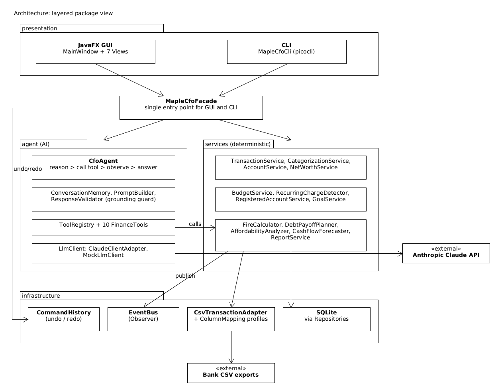

# MapleCFO 🍁

**An AI "CFO" for Canadian students and young professionals.** Import your bank CSVs and get clear answers about budgets, savings, TFSA/RRSP/FHSA room and debt. The AI never invents a number.

EECS3311 Software Design (Fall 2026) course project by Krishna Patel.

## What it does
- 📥 Imports bank CSVs and categorizes transactions, using rules first and AI for the rest
- 📊 Tracks net worth, budgets, subscriptions and savings goals
- 🇨🇦 Calculates TFSA / RRSP / FHSA room and warns before you over-contribute
- 🧮 Plans debt payoff (avalanche or snowball) and projects when you could retire early (FIRE)
- 🔄 **Auto-sync:** save bank CSVs into a folder and everything updates itself, including balances, debts, detected contributions and reminders
- 📅 **Self-updating CRA limits**, kept correct by a weekly GitHub Actions bot that opens a pull request (or an issue if something looks wrong)
- 🤖 **AI CFO chat** answers questions like *"Can I afford a $2,000 trip in December?"* by calling finance tools and explaining the results

## How the AI stays honest
- All numbers come from tested Java code. The AI only plans and explains.
- Answers are checked: every dollar amount must match what the tools returned.
- The AI can only *propose* changes. You confirm them, and you can undo them.
- It gives financial education only, never investment picks.

## Architecture


## Diagrams
| Diagram | Link |
|---|---|
| Use-case diagram | [usecase.png](docs/stage1/diagrams/png/usecase.png) |
| Class diagram: 1 Domain · 2 Import · 3 Services · 4 Events/Commands · 5 AI agent · 6 UI/Facade · 7 Automation | [1](docs/stage1/diagrams/png/class_domain.png) · [2](docs/stage1/diagrams/png/class_import.png) · [3](docs/stage1/diagrams/png/class_planning.png) · [4](docs/stage1/diagrams/png/class_events.png) · [5](docs/stage1/diagrams/png/class_agent.png) · [6](docs/stage1/diagrams/png/class_ui.png) · [7](docs/stage1/diagrams/png/class_automation.png) |
| Sequence: import · undo · net worth · TFSA room · FIRE/debt | [SD01](docs/stage1/diagrams/png/sd01_import.png) · [SD02](docs/stage1/diagrams/png/sd02_edit_undo.png) · [SD03](docs/stage1/diagrams/png/sd03_networth.png) · [SD04](docs/stage1/diagrams/png/sd04_room.png) · [SD05](docs/stage1/diagrams/png/sd05_planning.png) |
| Sequence: subscriptions · goals · **AI CFO agent** · afford check · monthly summary | [SD06](docs/stage1/diagrams/png/sd06_insights.png) · [SD07](docs/stage1/diagrams/png/sd07_goal.png) · [SD08](docs/stage1/diagrams/png/sd08_agent.png) · [SD09](docs/stage1/diagrams/png/sd09_afford.png) · [SD10](docs/stage1/diagrams/png/sd10_report.png) |
| Sequence: auto-sync · limits refresh · weekly limits bot · RRSP estimate | [SD11](docs/stage1/diagrams/png/sd11_autosync.png) · [SD12](docs/stage1/diagrams/png/sd12_limits_refresh.png) · [SD13](docs/stage1/diagrams/png/sd13_limits_bot.png) · [SD14](docs/stage1/diagrams/png/sd14_rrsp_estimate.png) |

All diagrams are made in **[UMLet](https://www.umlet.com)**. Editable UMLet files are in [`docs/stage1/diagrams/uxf/`](docs/stage1/diagrams/uxf/) and the exported images in [`docs/stage1/diagrams/png/`](docs/stage1/diagrams/png/).

## Build and run
Prerequisites: Java 21 (for example Temurin 21) and Maven 3.9+.

```
mvn test          # run the unit tests
mvn package       # build target/maplecfo.jar (all libraries included)
```

### GUI (JavaFX)
```
java -jar target/maplecfo.jar gui
```
The window has a sidebar with one page per feature:

| Group | Pages |
|---|---|
| — | **Home** (getting-started checklist, this month's numbers, things that need your OK, quick question box) · **Ask MapleCFO** (AI chat) |
| Money | **Transactions** (import a bank CSV, fix categories in the table) · **Budgets** · **Subscriptions & bills** · **Accounts & net worth** |
| Plan | **Savings goals** · **Can I afford it?** · **TFSA · RRSP · FHSA** · **Debt payoff** · **Retirement (FIRE)** |
| Reports | **Monthly report** · **Settings** (AI status, automatic import folder, contribution limits, reminders) |

New items are added with a button that opens a short form (for example **Add account**, **New goal**, **Set a budget**).
Undo/Redo are at the top right (Cmd/Ctrl+Z, Cmd/Ctrl+Shift+Z). While the window is open, CSV files saved into
the import folder (default `~/.maplecfo/inbox`, change it in **Settings**) are imported automatically.
At the start of every month, Home shows a short **monthly check-in** (import last month's CSVs, update balances,
review budgets and TFSA/RRSP/FHSA room) until you mark it done. The look uses the open-source AtlantaFX theme.

### Command-line interface
```
java -jar target/maplecfo.jar --help
java -jar target/maplecfo.jar            # interactive mode (undo/redo and AI proposals work across commands)
```
Data is stored locally in `~/.maplecfo/maplecfo.db` (change it with `--db <file>` or the `MAPLECFO_DB` environment variable).

Example session with the fake sample data:
```
# F01/F02 import and categorise
java -jar target/maplecfo.jar import sample-data/td_chequing_sample.csv -a chequing      # bank format detected automatically
java -jar target/maplecfo.jar import sample-data/rbc_visa_sample.csv -a visa -p RBC         # or choose it with -p
java -jar target/maplecfo.jar tx list --review
# F03 net worth, F09 goals, F11 affordability
java -jar target/maplecfo.jar account add "TD Chequing" CHEQUING 2500 --bank TD
java -jar target/maplecfo.jar account add "RBC Visa" CREDIT_CARD 800 --bank RBC
java -jar target/maplecfo.jar networth
java -jar target/maplecfo.jar goal add "Emergency fund" 5000 --by 2027-06-30 --saved 1000
java -jar target/maplecfo.jar goal list
java -jar target/maplecfo.jar afford 1500 --by 2027-03-31
# F04 budgets, F05 subscriptions
java -jar target/maplecfo.jar budget set DINING 150 -m 2026-10
java -jar target/maplecfo.jar budget status -m 2026-10
java -jar target/maplecfo.jar recurring
# F06 registered accounts, F14 RRSP estimate
java -jar target/maplecfo.jar profile set --birth-year 2003 --resident-since 2010 --rrsp-limit 5200 --fhsa-opened 2025
java -jar target/maplecfo.jar room
java -jar target/maplecfo.jar room check TFSA 3000
java -jar target/maplecfo.jar rrsp-estimate -y 2027
# F07 FIRE, F08 debt payoff
java -jar target/maplecfo.jar fire --invested 10000 --save 15000 --spend 40000 --age 23
java -jar target/maplecfo.jar debt add "RBC Visa" --balance 2400 --apr 20.99 --min 60
java -jar target/maplecfo.jar debt plan --compare --extra 200
# F10 AI CFO, F12 monthly report
java -jar target/maplecfo.jar ask "How much did I spend on dining last month?"
java -jar target/maplecfo.jar ask "Can I afford a 1500 dollar trip by March?"
java -jar target/maplecfo.jar report -m 2026-09
# F13 auto-import and reminders, F15 limits
java -jar target/maplecfo.jar inbox ~/Downloads/bank          # choose the folder MapleCFO watches for CSVs
java -jar target/maplecfo.jar watch --once
java -jar target/maplecfo.jar reminders
java -jar target/maplecfo.jar checkin                          # the monthly check-in list (checkin --done when finished)
java -jar target/maplecfo.jar limits refresh --force
```
Changes the AI (or the contribution detector) proposes are only applied after `confirm <id>`; use interactive mode or the GUI for that, because proposals live only while the app is open.

### Local configuration (API key)
```
cp .env.example .env
```
Then put your own key in `.env`. The `.env` file is git-ignored, so the key is never committed.
Without a key, MapleCFO runs in **demo mode**: an offline mock model answers from the same tools, so every feature can still be tried.

Optional settings (in `.env` or as environment variables): `LLM_MODEL` (default `claude-haiku-5-5`), `LLM_WORKSPACE_ID`, `MAPLECFO_DB`, `MAPLECFO_INBOX` (auto-import folder; overrides the one chosen in Settings), `MAPLECFO_LIMITS_URL`.

### Weekly limits bot (F15)
`.github/workflows/limits-update.yml` runs every Monday. It reads the CRA limits page, validates any new TFSA/RRSP numbers and opens a pull request for review. The app downloads `contribution_limits.json` from this repository at most once a week, validates it again and keeps a local cache.

## Tech stack
Java 21 · JavaFX (GUI) · picocli (CLI) · SQLite · Anthropic Claude API · GitHub Actions · JUnit 5 · KUMA

## Design at a glance
- **15 features** (11 deterministic, 1 AI, 3 hybrid)
- **8 design patterns:** Facade, Adapter, Template Method, Factory Method, Strategy, Observer, Command, Composite

📄 Full design (UML, use cases, sequence diagrams, traceability): [Stage 1 Design Report](docs/stage1/Stage1_Design_Report.md) · [PDF](docs/stage1/Stage1_Design_Report.pdf)

## Project stages
| Stage | Status |
|---|---|
| 1: Design | ✅ Done |
| 2: Build with AI | 🚧 In progress: all 15 features built (GUI + CLI) |
| 3: Testing (JUnit + KUMA) | ⏳ |

> *Educational project: MapleCFO provides financial information, not professional financial advice.*
