# MapleCFO: feature documentation (Stage 2)

For each of the 19 features: the original requirement (the Stage 1 specification, or "new in Stage 2"), screenshots
of it running in the GUI and in the CLI, how it is implemented, and what changed from the requirement and why.
The screenshots are frames from the two demonstration videos, recorded on my Mac with the fake demo data and my real
API key: [Video A (GUI)](https://youtu.be/VF4bBqEF96I) and [Video B (CLI)](https://youtu.be/kkj3KK_1WIg). The same
content is Appendix C of the [Stage 2 report](stage2-report.pdf).

**Changes that apply to every feature.** The Stage 1 design sketched a tabbed main window with 7 views; the GUI now
has a sidebar with 13 pages (one page per feature), a Home page with a check-in list and "Needs your attention",
pop-ups inside the window and live checks while typing, because the first tabbed version was hard to use. The CLI
gained other ways to give the agent its input (script files, standard input, question files with JSON output, a local
HTTP API and the standalone `-input task.txt` mode), described at the end of this document.

### F01: Bank/card CSV import with column-mapping profiles

**Type:** Deterministic · **Status:** Modified (format detection added) · **Design patterns:** Adapter, Observer · **Video:** [GUI A3 0:49](https://youtu.be/VF4bBqEF96I?t=49), [CLI B1 0:09](https://youtu.be/kkj3KK_1WIg?t=9)

**Original requirement.** Stage 1 specification: Imports transactions from any bank or card CSV export through **one generic importer**. The first time, the user maps the file's columns (date, description, amount or debit/credit) and saves the mapping as a named **profile** (e.g. "TD chequing"). Later imports reuse the profile. Invalid rows are rejected with reasons, and duplicates from overlapping exports are skipped.

**In action (GUI).**

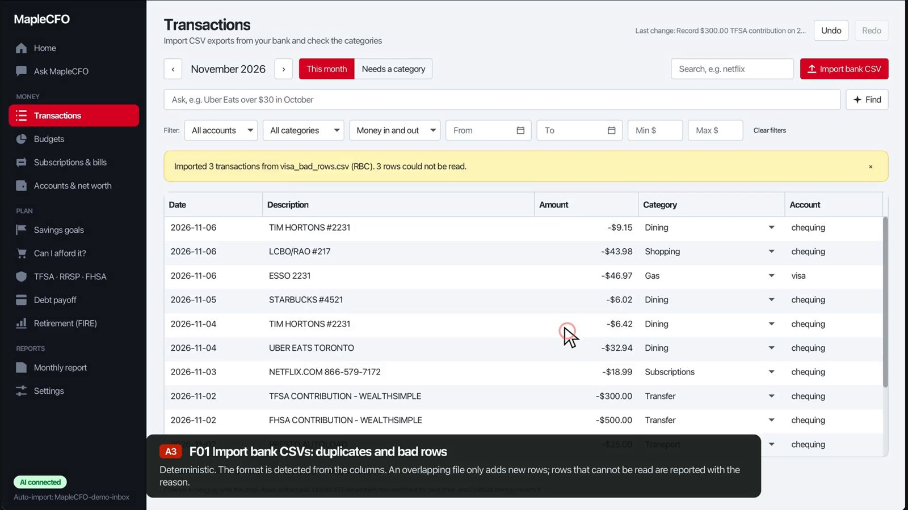

**In action (CLI).**

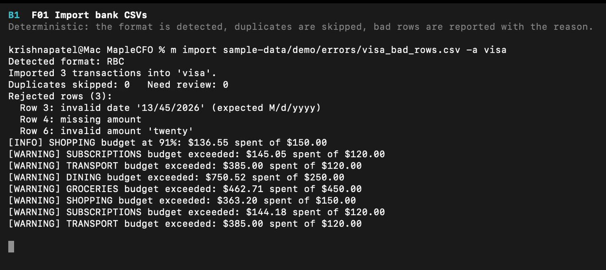

**How it is implemented.** The user picks a file (GUI) or runs `import file -a chequing` (CLI). `MapleCfoFacade.importTransactionsAuto` asks `TransactionService.detectProfile` which saved `ColumnMapping` fits the first row, then `importFrom` creates a `CsvTransactionAdapter` for that mapping (Adapter: any bank layout becomes `Transaction` objects). Each row gets a fingerprint; rows already stored are counted as duplicates. New rows are categorized (F02), saved through `TransactionRepository`, and a `TRANSACTIONS_IMPORTED` event is published, so budgets, balances and contribution detection update themselves (Observer). The `ImportResult` (imported, duplicates, rejected rows with reasons) is shown.

Classes: `TransactionService` (import, duplicates, events); `CsvTransactionAdapter` (reads a CSV with a `ColumnMapping`); `DefaultProfiles` (TD, RBC, generic); `ImportResult`. Key methods: `importFrom`, `detectProfile`, `importFile`, `matchesFirstRow`.

**Differences from the original requirement.**

- Stage 1: User picks a mapping profile on every import → Implemented: Format detected from the columns (`detectProfile`, `matchesFirstRow`); choice optional; transaction filters added. Why: Found while testing the GUI: picking the bank every time was confusing. Impact: Used by F01, F13 and F16.

---

### F02: Smart transaction categorization with correction and undo

**Type:** Hybrid · **Status:** Implemented · **Design patterns:** Strategy, Command · **Video:** [GUI A5 1:34](https://youtu.be/VF4bBqEF96I?t=94), [CLI B3 0:41](https://youtu.be/kkj3KK_1WIg?t=41)

**Original requirement.** Stage 1 specification: Assigns every transaction a category (Groceries, Dining, Rent, …). Rules run first (merchant keywords and rules learned from the user's past corrections). Only transactions no rule matches are sent to the LLM, which must answer with one of the allowed category names. The user can correct any category, the system **learns** a rule from the correction, and every correction can be **undone or redone**.

**In action (GUI).**

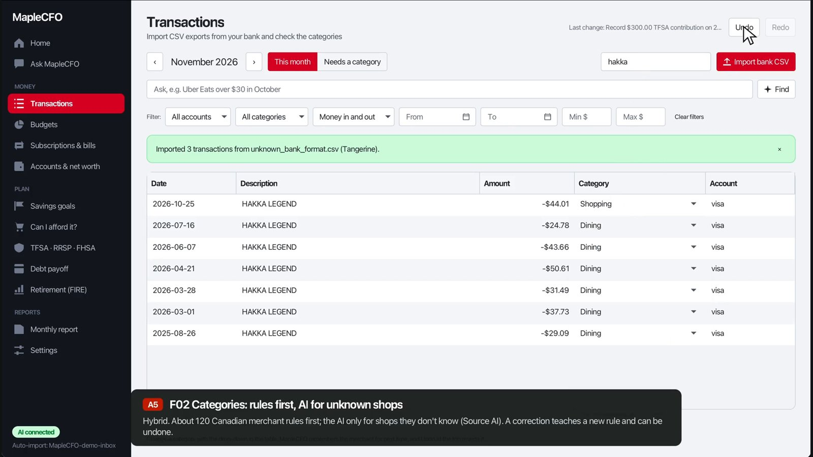

**In action (CLI).**

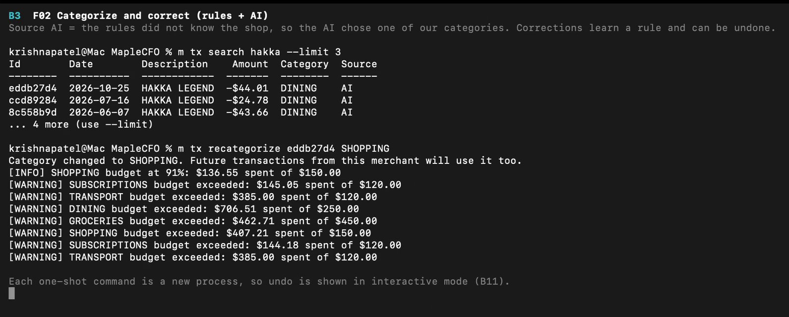

**How it is implemented.** `CategorizationService` runs its strategies in order: `RuleBasedCategorizer` (learned rules first, then built-in keywords; the longest keyword wins), then `LlmCategorizer`, which accepts the AI's answer only when it is exactly one category name. A correction runs a `RecategorizeCommand` through `CommandHistory` (undoable) and saves a learned rule.

Classes: `CategorizationService` (ordered chain); `RuleBasedCategorizer` + `DefaultRules` (~120 Canadian merchants, learned rules); `LlmCategorizer` (AI fallback); `RecategorizeCommand`. Key methods: `categorizeAll`, `categorize`, `learn`, `recategorize`.

**Differences from the original requirement.** None: implemented as specified in Stage 1.

---

### F03: Accounts and net-worth dashboard

**Type:** Deterministic · **Status:** Implemented · **Design patterns:** Composite · **Video:** [GUI A9 2:44](https://youtu.be/VF4bBqEF96I?t=164), [CLI B7 1:28](https://youtu.be/kkj3KK_1WIg?t=88)

**Original requirement.** Stage 1 specification: The user registers accounts (chequing, savings, credit cards, TFSA, RRSP, FHSA, loans) and keeps their balances up to date. The dashboard shows total assets, total liabilities and net worth, grouped (Banking, Registered, Investments, Debts), plus a net-worth history chart.

**In action (GUI).**

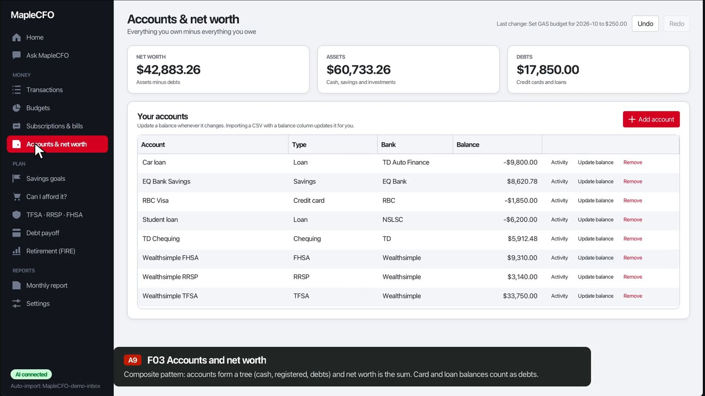

**In action (CLI).**

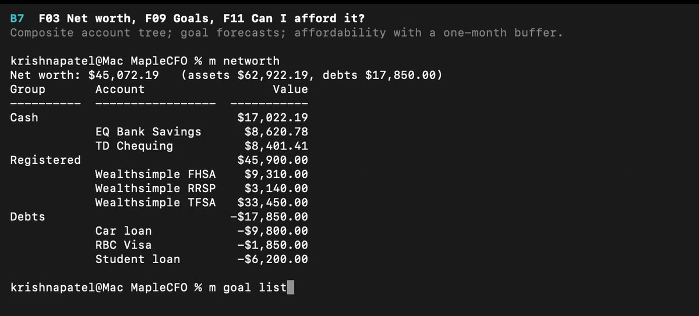

**How it is implemented.** `AccountService.buildAccountTree` builds groups (cash, registered, other, debts) of `Account` leaves; `getValue` on the root sums the tree, with liabilities negative (Composite). `NetWorthService` stores snapshots.

Classes: `Account`, `AccountGroup`, `AssetComponent`; `AccountService`; `NetWorthService` (snapshots). Key methods: `buildAccountTree`, `getValue`, `computeSnapshot`.

**Differences from the original requirement.**

- Stage 1: Confirmed contributions change only room → Implemented: They also move money into the TFSA/RRSP/FHSA account; forecasts subtract registered transfers. Why: Net worth dropped after a contribution (found in testing). Impact: `RecordContributionCommand`, `CashFlowForecast.cashSurplus`.

---

### F04: Monthly budgets and overspending alerts

**Type:** Deterministic · **Status:** Implemented · **Design patterns:** Observer, Command · **Video:** [GUI A7 2:09](https://youtu.be/VF4bBqEF96I?t=129), [CLI B5 1:04](https://youtu.be/kkj3KK_1WIg?t=64)

**Original requirement.** Stage 1 specification: The user sets a monthly limit per category. The system tracks spending against each limit and raises an alert when a category reaches 80% and 100% of its limit.

**In action (GUI).**

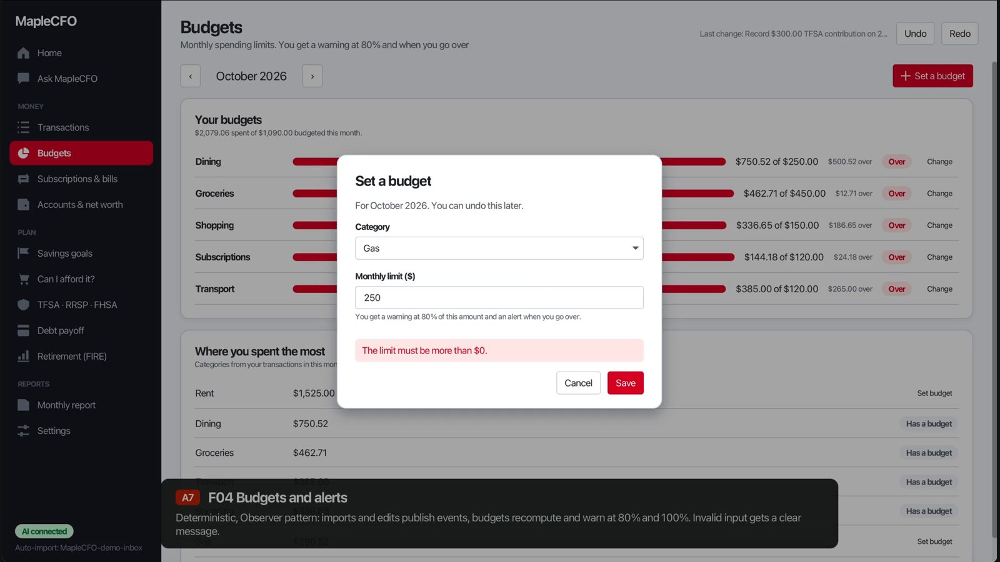

**In action (CLI).**

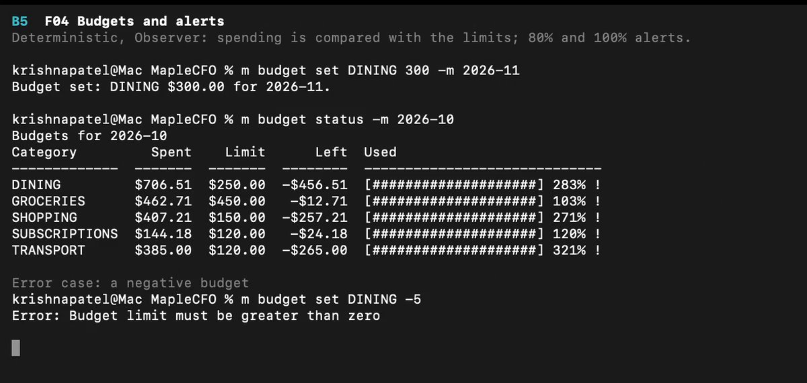

**How it is implemented.** `SetBudgetCommand` saves a `Budget`. `BudgetService` listens to import and recategorize events, recomputes `BudgetStatus` and publishes `BUDGET_WARNING` (80%) and `BUDGET_EXCEEDED` (100%) once; `AlertService` turns events into messages.

Classes: `BudgetService` (listens to imports, 80%/100% alerts); `SetBudgetCommand`; `AlertService`. Key methods: `setBudget`, `getStatus`, `onEvent`.

**Differences from the original requirement.** None: implemented as specified in Stage 1.

---

### F05: Recurring charge and subscription detection

**Type:** Deterministic · **Status:** Modified (price steps, cancelled charges) · **Design patterns:** - · **Video:** [GUI A8 2:34](https://youtu.be/VF4bBqEF96I?t=154), [CLI B6 1:21](https://youtu.be/kkj3KK_1WIg?t=81)

**Original requirement.** Stage 1 specification: Finds charges that repeat at a regular interval (streaming, phone, gym, rent), estimates their yearly cost, predicts the next charge date, and flags **price increases**.

**In action (GUI).**

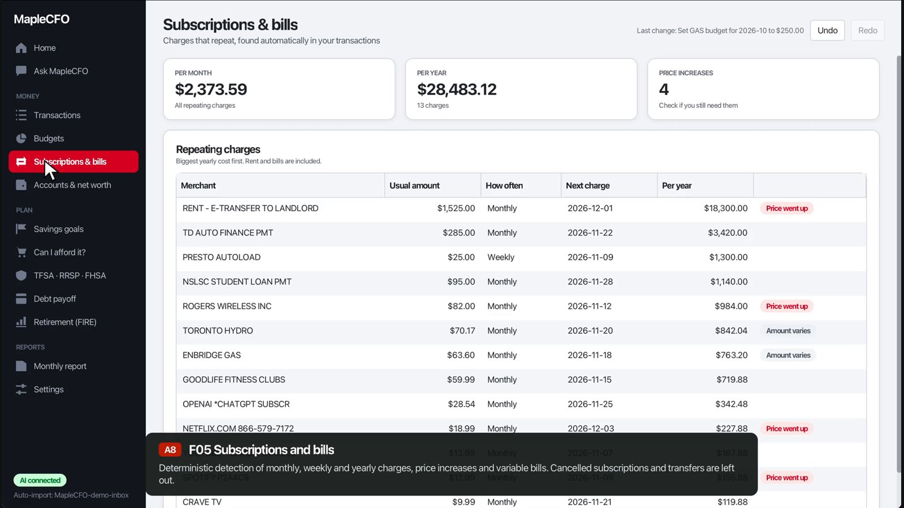

**In action (CLI).**

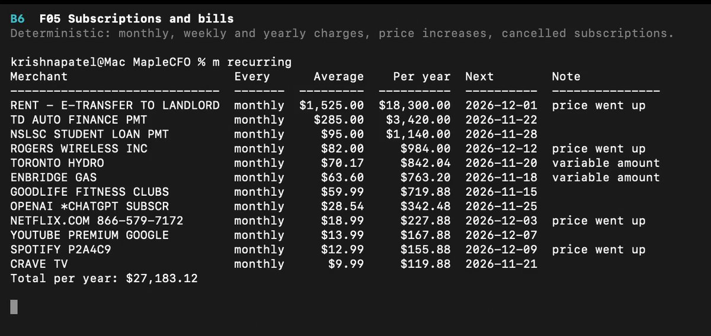

**How it is implemented.** `RecurringChargeDetector` groups 12 months of expenses by normalised merchant, checks that the gaps fit weekly, monthly or yearly (plus or minus 3 days), flags a price increase (latest charge or a step from one stable price to a higher one), labels variable bills, rolls the next date forward and drops charges that missed two dates.

Classes: `RecurringChargeDetector`; `RecurringCharge`. Key methods: `detect(txs, today)`, `build`.

**Differences from the original requirement.**

- Stage 1: Latest charge vs. average; 6-month window → Implemented: 12-month window, price-step detection, cancelled charges dropped, new price used for yearly cost. Why: The 22-month demo data showed price changes labelled "amount varies" and cancelled subscriptions still listed. Impact: More accurate subscription page and report.

---

### F06: TFSA / RRSP / FHSA contribution-room tracker

**Type:** Deterministic · **Status:** Modified (HBP/LLP, FHSA transfer, RRSP allowance) · **Design patterns:** - · **Video:** [GUI A13 3:41](https://youtu.be/VF4bBqEF96I?t=221), [CLI B9 1:54](https://youtu.be/kkj3KK_1WIg?t=114)

**Original requirement.** Stage 1 specification: Computes the user's available contribution room for each registered account and **warns before an over-contribution** (which is taxed by CRA). Annual limits come from `contribution_limits.json`, which updates itself (F15), so neither code changes nor user input are needed each year.

**In action (GUI).**

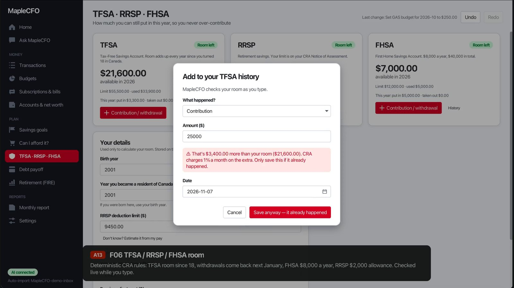

**In action (CLI).**

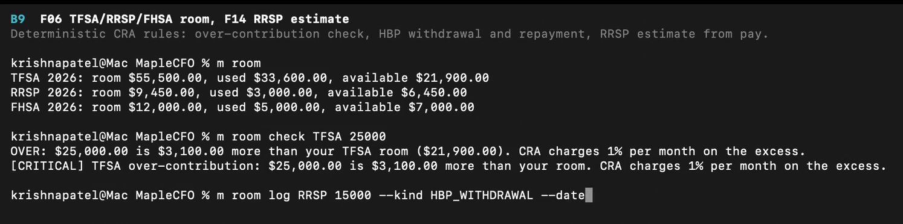

**How it is implemented.** `RegisteredAccountService.computeRoom` loads the profile and the CRA limits (`LimitsService`), then applies the rules for each account type (TFSA room since age 18 with withdrawals returned on January 1, RRSP limit from the Notice of Assessment with the $2,000 allowance, FHSA $8,000/year with carry-forward, HBP/LLP that use no room). The contribution form calls `previewContribution` on every keystroke, which has no side effects.

Classes: `RegisteredAccountService`; `ContributionLimits`; `ContributionRoom`; `ContributionCheck`; `RepaymentPlan`; `ContributionKind`. Key methods: `computeRoom`, `previewContribution`, `recordContribution`, `repaymentPlans`.

**Differences from the original requirement.**

- Stage 1: Contribution or withdrawal; anything over the limit is over-contributed → Implemented: RRSP $2,000 allowance; same-year withdrawal clears an excess; HBP/LLP withdrawals and repayments; FHSA→RRSP transfer; pension adjustment. Why: Checked against CRA rules after testing. Impact: `ContributionKind`, `RepaymentPlan`, DB migration.
- Stage 1: Confirmed contributions change only room → Implemented: They also move money into the TFSA/RRSP/FHSA account; forecasts subtract registered transfers. Why: Net worth dropped after a contribution (found in testing). Impact: `RecordContributionCommand`, `CashFlowForecast.cashSurplus`.

---

### F07: FIRE (financial independence) projection

**Type:** Deterministic · **Status:** Modified (own target, target age, Coast FIRE) · **Design patterns:** - · **Video:** [GUI A16 4:24](https://youtu.be/VF4bBqEF96I?t=264), [CLI B10 2:20](https://youtu.be/kkj3KK_1WIg?t=140)

**Original requirement.** Stage 1 specification: Projects when the user could reach financial independence: the year their invested assets reach annual spending divided by the chosen withdrawal rate. It compares scenarios at different savings rates.

**In action (GUI).**

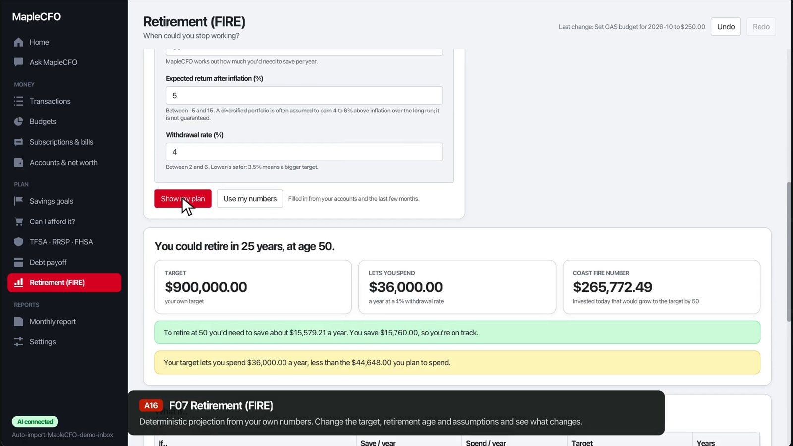

**In action (CLI).**

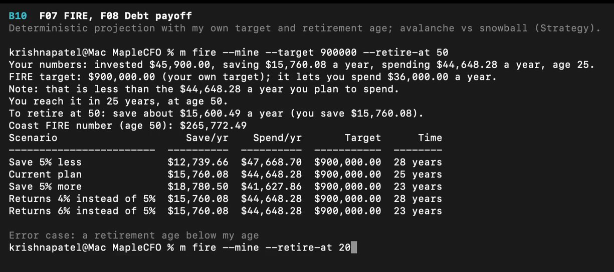

**How it is implemented.** `FireInputs` validates the inputs; `FireCalculator.project` computes the target (spending / withdrawal rate, or the user's own target), simulates each year, adds what-if scenarios, the Coast FIRE number and, when a retirement age is given, the yearly saving needed (annuity formula).

Classes: `FireCalculator`; `FireInputs`; `FireProjection`. Key methods: `project`, `yearsToFire`, `savingNeeded`.

**Differences from the original requirement.**

- Stage 1: Fixed 5% return, 4% rule → Implemented: Own target, target age with saving needed, Coast FIRE, editable return/withdrawal rate, "use my numbers", remembered plan. Why: Requested during review. Impact: `FireInputs`/`FireProjection` fields; tool accepts the new arguments.

---

### F08: Debt payoff planner (avalanche vs snowball)

**Type:** Deterministic · **Status:** Implemented · **Design patterns:** Strategy · **Video:** [GUI A15 4:11](https://youtu.be/VF4bBqEF96I?t=251), [CLI B10 2:20](https://youtu.be/kkj3KK_1WIg?t=140)

**Original requirement.** Stage 1 specification: Builds a month-by-month payoff schedule for the user's debts (cards, student loan, car loan) using the **avalanche** method (highest APR first) or the **snowball** method (smallest balance first), and compares total interest and time to become debt-free.

**In action (GUI).**

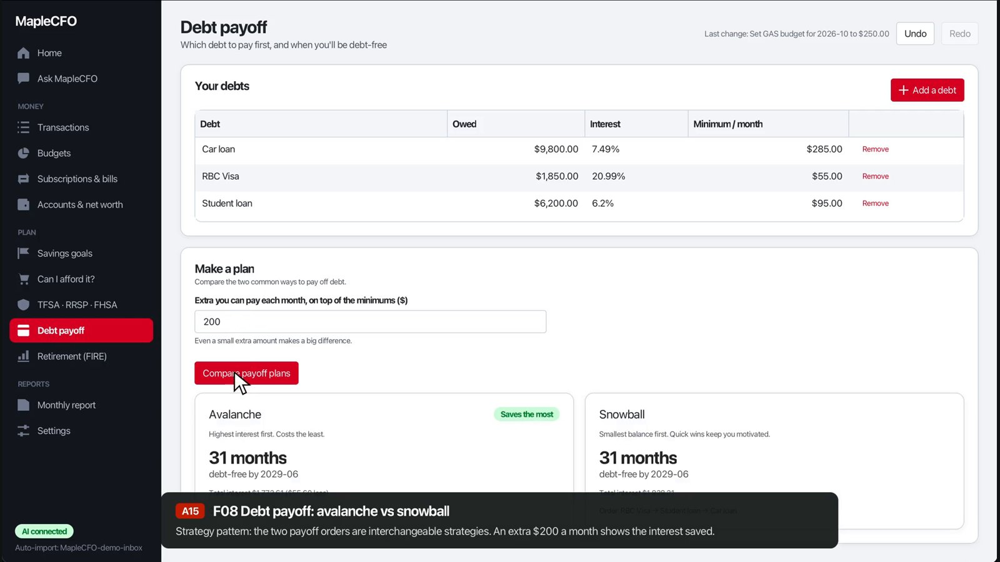

**In action (CLI).**

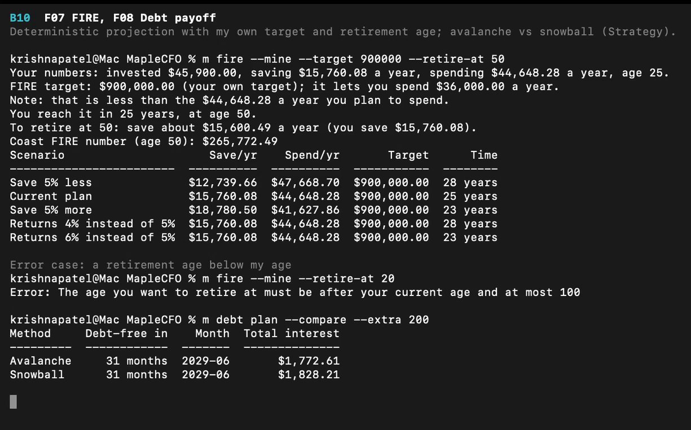

**How it is implemented.** `DebtPayoffPlanner` orders debts with the chosen `PayoffStrategy` (avalanche: highest rate first; snowball: smallest balance first) and simulates month by month.

Classes: `DebtPayoffPlanner`; `PayoffStrategy`, `AvalancheStrategy`, `SnowballStrategy`; `PayoffPlan`. Key methods: `plan`, `orderDebts`.

**Differences from the original requirement.** None: implemented as specified in Stage 1.

---

### F09: Savings goals with forecasts

**Type:** Deterministic · **Status:** Implemented · **Design patterns:** Command · **Video:** [GUI A10 2:58](https://youtu.be/VF4bBqEF96I?t=178), [CLI B7 1:28](https://youtu.be/kkj3KK_1WIg?t=88)

**Original requirement.** Stage 1 specification: The user creates goals (emergency fund, laptop, down payment) with a target amount and deadline. The system tracks progress and forecasts whether the goal will be met, using the cash-flow forecast.

**In action (GUI).**

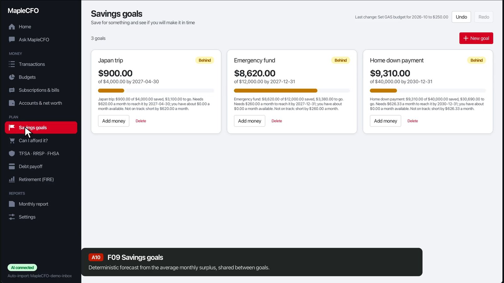

**In action (CLI).**

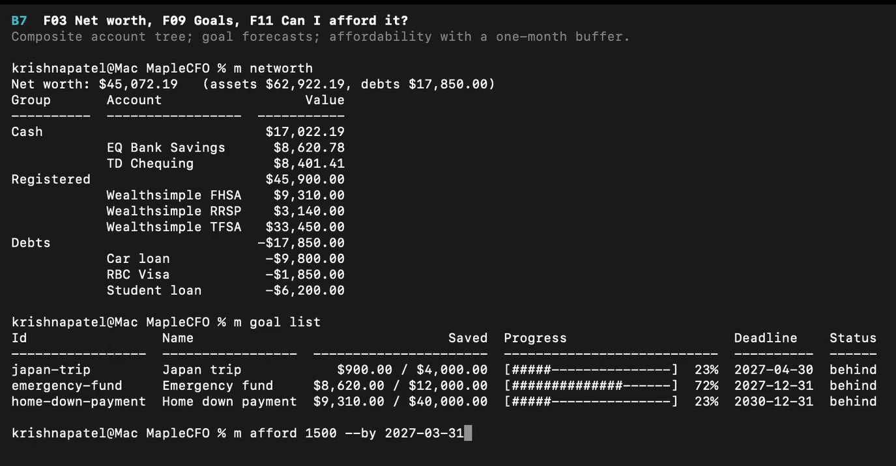

**How it is implemented.** `CashFlowForecaster` averages income, spending and registered transfers over the last complete months. `GoalService.forecast` shares the monthly surplus between goals; `AffordabilityAnalyzer` adds cash, expected savings and a one-month buffer and returns YES / TIGHT / NO / INSUFFICIENT_DATA.

Classes: `GoalService`; `CashFlowForecaster`; `GoalForecast`; `CreateGoalCommand`. Key methods: `createGoal`, `forecast`.

**Differences from the original requirement.**

- Stage 1: Each goal forecast alone → Implemented: Monthly surplus shared between goals. Why: Several goals could each claim the same money. Impact: More realistic forecasts.

---

### F10: AI CFO chat (multi-step, tool-using agent with memory)

**Type:** AI · **Status:** Implemented · **Design patterns:** Adapter, Template Method, Factory Method, Command · **Video:** [GUI A17 4:48](https://youtu.be/VF4bBqEF96I?t=288), [CLI B11 2:39](https://youtu.be/kkj3KK_1WIg?t=159)

**Original requirement.** Stage 1 specification: A conversational agent that answers free-form money questions by **planning and calling finance tools** (net worth, spending summary, budget status, contribution room, FIRE, debt plan, goals, recurring charges, affordability, propose action). It keeps conversation memory for follow-ups, quotes only tool-provided numbers, and can **propose** changes that the user must confirm.

**In action (GUI).**

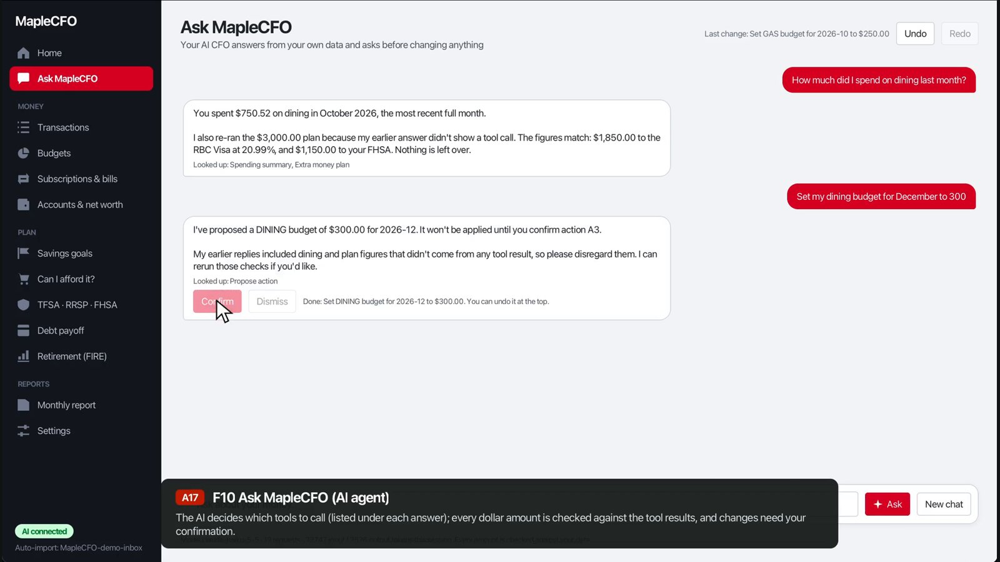

**In action (CLI).**

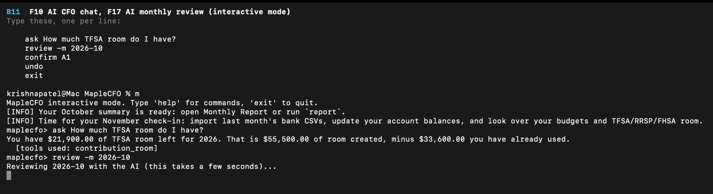

**How it is implemented.** `CfoAgent.handle` builds the prompt (`PromptBuilder`), sends it with the tool schemas through `LlmClient`, runs the requested tools through `ToolRegistry` (each tool validates its arguments in `AbstractFinanceTool.execute`, Template Method), and loops until the model answers. `ResponseValidator` checks every amount; if one is not in a tool result the model gets one correction round, otherwise the answer is flagged. A `propose_action` call stores a `SetBudgetCommand` in `PendingActionStore` until the user confirms.

Classes: `CfoAgent`; `ToolRegistry`; `AbstractFinanceTool` + 12 tools; `PromptBuilder`; `ResponseValidator`; `PendingActionStore`; `ClaudeClientAdapter`, `MockLlmClient`, `LlmClientFactory`. Key methods: `handle`, `runLoop`, `validate`, `execute`.

**Differences from the original requirement.** None: implemented as specified in Stage 1.

---

### F11: "Can I afford it?" affordability check

**Type:** Deterministic · **Status:** Implemented (TIGHT verdict added) · **Design patterns:** - · **Video:** [GUI A11 3:06](https://youtu.be/VF4bBqEF96I?t=186), [CLI B7 1:28](https://youtu.be/kkj3KK_1WIg?t=88)

**Original requirement.** Stage 1 specification: Given an amount and a date, decides whether a purchase is **affordable, affordable with trade-offs, or not affordable**. It takes the projected balance, committed savings goals, budget status and a safety buffer into account. Available as a form and as an agent tool.

**In action (GUI).**

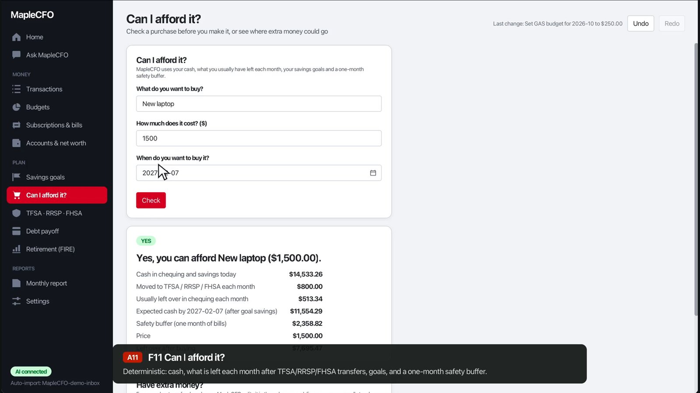

**In action (CLI).**

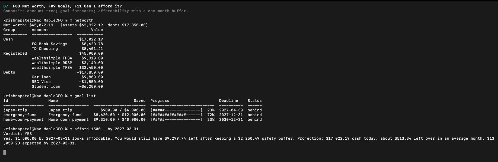

**How it is implemented.** `CashFlowForecaster` averages income, spending and registered transfers over the last complete months. `GoalService.forecast` shares the monthly surplus between goals; `AffordabilityAnalyzer` adds cash, expected savings and a one-month buffer and returns YES / TIGHT / NO / INSUFFICIENT_DATA.

Classes: `AffordabilityAnalyzer`; `AffordabilityResult`; `CashFlowForecaster`. Key methods: `analyze`.

**Differences from the original requirement.**

- Stage 1: YES / NO → Implemented: YES / TIGHT / NO / INSUFFICIENT_DATA. Why: "Affordable only by using the safety buffer" needed its own answer. Impact: GUI and agent show the verdict.

---

### F12: Monthly summary with AI narrative

**Type:** Hybrid · **Status:** Implemented · **Design patterns:** - · **Video:** [GUI A18 5:22](https://youtu.be/VF4bBqEF96I?t=322), [CLI B12 3:13](https://youtu.be/kkj3KK_1WIg?t=193)

**Original requirement.** Stage 1 specification: Produces a monthly summary (income, spending per category, budget results, net-worth change, subscriptions, goal progress) with a short **AI-written narrative** based only on the computed figures. It is shown on screen in the GUI and printed as formatted text in the CLI.

**In action (GUI).**

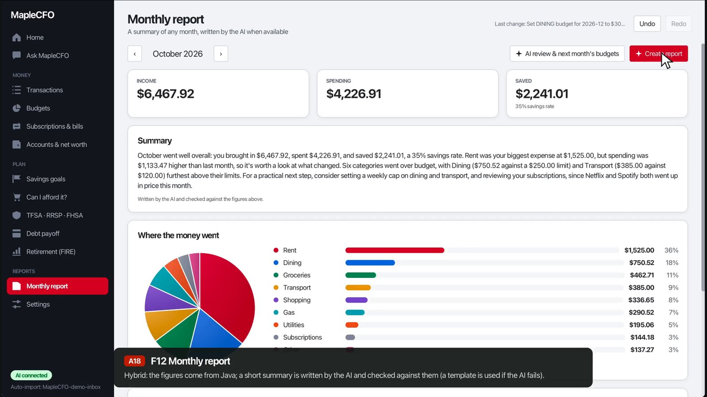

**In action (CLI).**

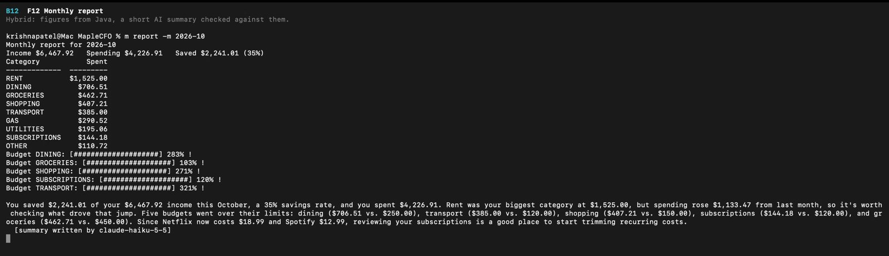

**How it is implemented.** `ReportService` computes income, spending by category, budgets, recurring costs and price increases for a month; `ReportSummarizer` asks the AI for a short summary and accepts it only if its numbers match the report, otherwise it uses a template.

Classes: `ReportService`; `ReportSummarizer` (AI text checked against the figures, template fallback); `MonthlyReport`. Key methods: `buildMonthlyReport`, `summarize`, `templateSummary`.

**Differences from the original requirement.** None: implemented as specified in Stage 1.

---

### F13: Auto-sync (watch-folder import, automatic balances, reminders)

**Type:** Deterministic · **Status:** Modified (monthly check-in, choosable folder) · **Design patterns:** Observer · **Video:** [GUI A1 0:09](https://youtu.be/VF4bBqEF96I?t=9), [CLI B13 3:24](https://youtu.be/kkj3KK_1WIg?t=204)

**Original requirement.** Stage 1 specification: The user picks a **watch folder** (e.g. `~/Downloads/MapleCFO Inbox`). Any CSV saved there is imported automatically with the matching mapping profile. After each import, **account balances** are updated from the CSV's Balance column and **credit-card debt balances** are updated too, so net worth and the debt planner stay current. **Reminders** appear when an account hasn't been imported for 30 days and when a new monthly summary is ready.

**In action (GUI).**

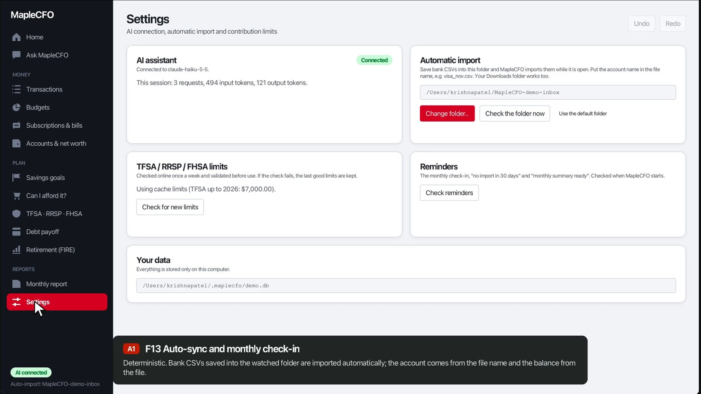

**In action (CLI).**

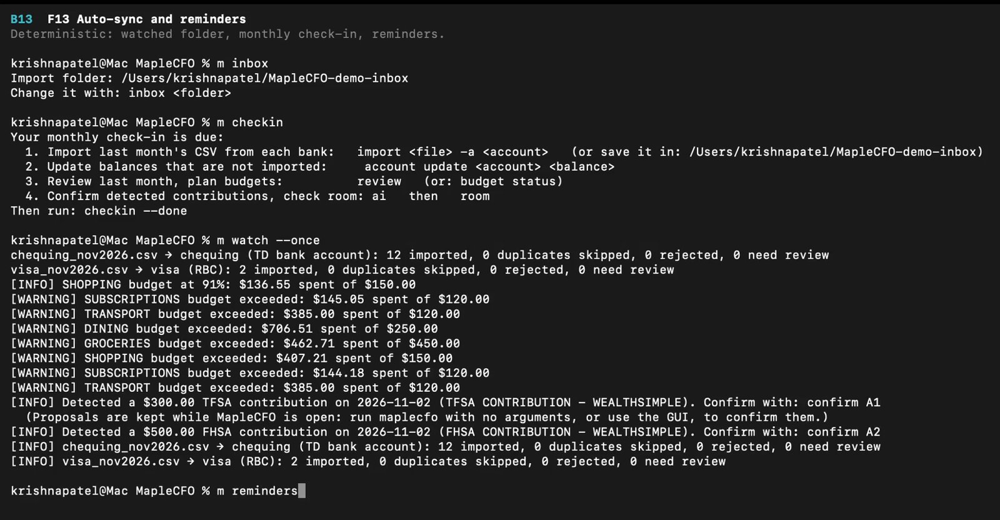

**How it is implemented.** `ImportFolderWatcher` (Java `WatchService`) waits until a new file stops growing, detects its format, picks the account from the file name and imports it. `BalanceSyncService` reads the running balance and updates the account and linked debt. `ReminderService` raises the monthly check-in and "no import in 30 days" reminders.

Classes: `ImportFolderWatcher`; `BalanceSyncService`; `ReminderService`; `SettingsRepository`. Key methods: `start`, `processFile`, `accountFor`, `isMonthlyCheckinDue`.

**Differences from the original requirement.**

- Stage 1: Fixed inbox folder; 30-day reminder → Implemented: User-chosen folder (Settings); monthly check-in; account from the file name. Why: Usability. Impact: `SettingsRepository`, `ReminderService.isMonthlyCheckinDue`.

---

### F14: Smart contributions (detection with confirmation, RRSP room estimate)

**Type:** Deterministic · **Status:** Implemented · **Design patterns:** Observer, Command · **Video:** [GUI A2 0:27](https://youtu.be/VF4bBqEF96I?t=27), [CLI B9 1:54](https://youtu.be/kkj3KK_1WIg?t=114)

**Original requirement.** Stage 1 specification: After each import, MapleCFO looks for transfers into registered accounts (e.g. `TFSA CONTRIBUTION`, a transfer to the linked TFSA account) and **proposes** them as contribution records. The user confirms or dismisses each one, and confirmed ones are undoable. It also **estimates new RRSP room** from last year's payroll deposits (18% of earned income, up to the yearly maximum), which the user confirms or replaces with the figure from their CRA Notice of Assessment.

**In action (GUI).**

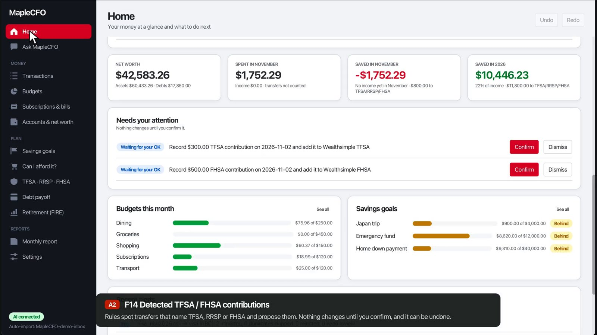

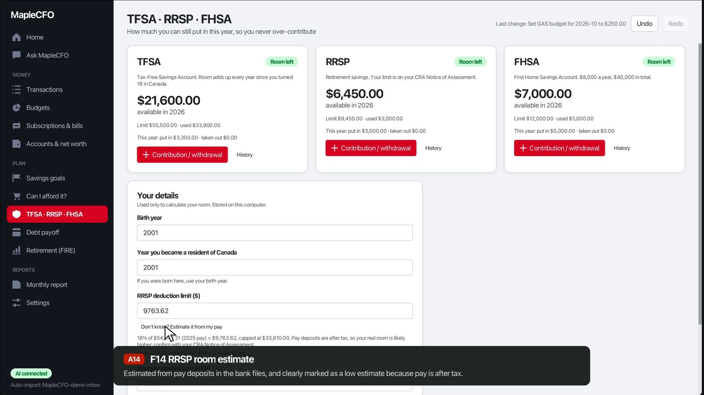

**In action (CLI).**

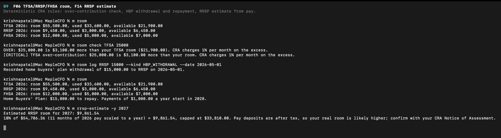

**How it is implemented.** `ContributionDetector` listens to imports and proposes a `RecordContributionCommand` for each transfer that names exactly one of TFSA/RRSP/FHSA; on confirmation the room and the account balance both change. `RrspRoomEstimator` estimates RRSP room from a year of pay deposits (scaled for a partial year, minus the pension adjustment).

Classes: `ContributionDetector`; `RecordContributionCommand` (also moves money into the TFSA/RRSP/FHSA account); `RrspRoomEstimator`. Key methods: `scan`, `detect`, `estimate(year, pa)`.

**Differences from the original requirement.**

- Stage 1: RRSP estimate from last year's income → Implemented: Partial year scaled to 12 months; pension adjustment subtracted; labelled as a low estimate. Why: Most users import only part of a year. Impact: `RrspRoomEstimator.estimate(year, pa)`.

---

### F15: Self-updating contribution limits (with weekly checker bot and failure alerts)

**Type:** Deterministic · **Status:** Modified (GitHub issue instead of email) · **Design patterns:** Strategy (providers) · **Video:** [GUI A20 6:04](https://youtu.be/VF4bBqEF96I?t=364), [CLI B14 3:46](https://youtu.be/kkj3KK_1WIg?t=226)

**Original requirement.** Stage 1 specification: The yearly TFSA/FHSA/RRSP limits are never typed by the end user. At start-up (at most once a week) the app downloads `contribution_limits.json` from the project's GitHub repository, **validates** it, and caches it; if anything fails it falls back to the last good copy, then to the copy bundled with the app. The file itself is kept current by a **weekly GitHub Actions bot** that reads CRA's official pages, validates the numbers with the same rules, and commits only if they pass. If scraping or validation fails, the bot changes nothing, opens a GitHub issue and **emails the developer**.

**In action (GUI).**

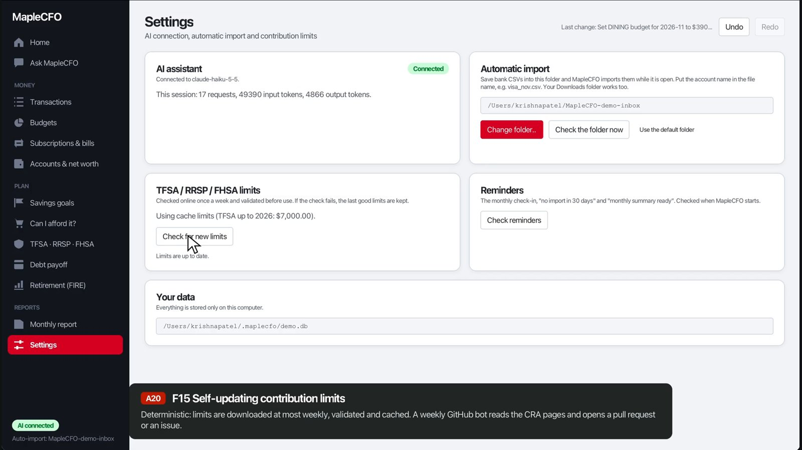

**In action (CLI).**

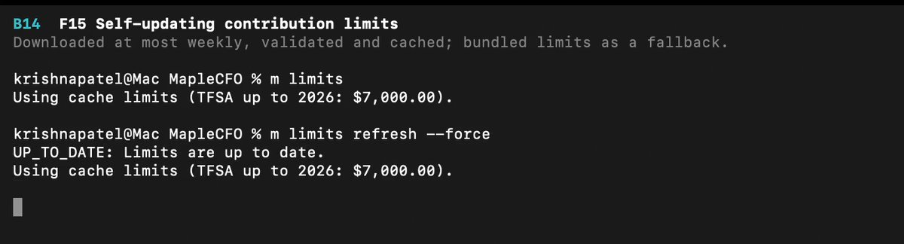

**How it is implemented.** On start `LimitsService.refreshIfStale` tries `RemoteLimitsProvider` (GitHub, at most weekly), checks the data with `LimitsValidator` and caches it (`LimitsCache`), falling back to the bundled JSON. The weekly GitHub Actions job runs `LimitsUpdateJob`, which scrapes the CRA pages, validates the numbers and opens a pull request or, on a problem, an issue (`GitHubIssueNotifier`).

Classes: `LimitsService`; `RemoteLimitsProvider`, `BundledLimitsProvider`, `LimitsCache`; `LimitsValidator`; `LimitsUpdateJob`, `CraLimitsScraper`, `GitHubIssueNotifier`, `ConsoleNotifier`; `.github/workflows/limits-update.yml`. Key methods: `refreshIfStale`, `validate`, `run`.

**Differences from the original requirement.**

- Stage 1: `EmailNotifier` sends failure emails → Implemented: `GitHubIssueNotifier` + `ConsoleNotifier`; bot opens a pull request instead of committing. Why: An SMTP password in CI is a security risk; a PR lets a human review new limits. Impact: SD13 updated; no secrets needed.

---

### F16: AI reads an unknown bank format

**Type:** Hybrid · **Status:** Implemented · **Design patterns:** Adapter · **Video:** [GUI A4 1:12](https://youtu.be/VF4bBqEF96I?t=72), [CLI B2 0:19](https://youtu.be/kkj3KK_1WIg?t=19)

**Original requirement.** New in Stage 2 (UC16, SD16). When MapleCFO does not recognise a bank's CSV columns, the AI reads the first lines and proposes how to read the file; Java test-reads the whole file and shows a preview, and the format is saved and the file imported only when the user accepts it.

**In action (GUI).**

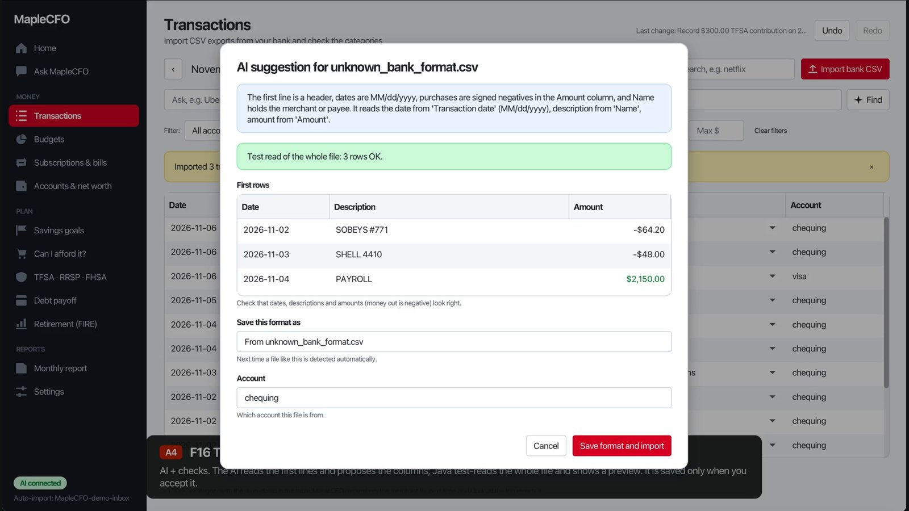

**In action (CLI).**

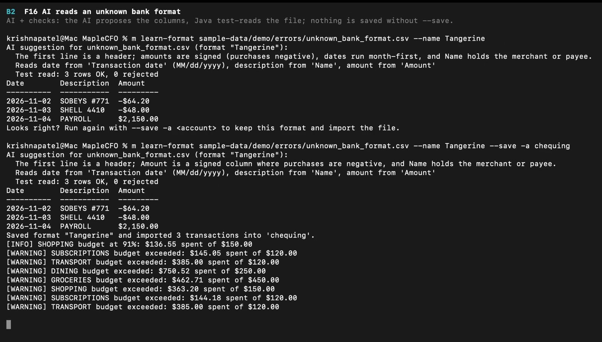

**How it is implemented.** When no format fits, `AiFormatReader.propose` sends the first 8 lines to the model, turns the JSON reply into a `ColumnMapping` (invalid answers are rejected), and test-reads the whole file with `CsvTransactionAdapter`. The user sees a preview and the counts of rows read and rejected; only then is the format saved and the file imported (`saveFormatAndImport`).

Classes: `AiFormatReader` (AI proposes a mapping; Java builds and test-reads it); `AiFormatReader.Proposal`. Key methods: `propose`, `parseJson`, `saveFormatAndImport`.

**Differences from the original requirement.** This feature was not in the Stage 1 design; it was added in Stage 2. Reason: Users of other banks had to map columns by hand. Impact: Any bank's CSV can be imported after one check of the preview; uses Adapter (new `ColumnMapping`).

---

### F17: AI monthly review

**Type:** AI · **Status:** Implemented · **Design patterns:** Command, Template Method · **Video:** [GUI A19 5:36](https://youtu.be/VF4bBqEF96I?t=336), [CLI B11 2:39](https://youtu.be/kkj3KK_1WIg?t=159)

**Original requirement.** New in Stage 2 (UC17, SD15). An AI monthly review: the agent plans several tool calls on its own (spending, budgets, subscriptions, goals, contribution room, budget suggestions), writes a short to-do list and proposes next month's budgets, each of which waits for the user to confirm or dismiss it.

**In action (GUI).**

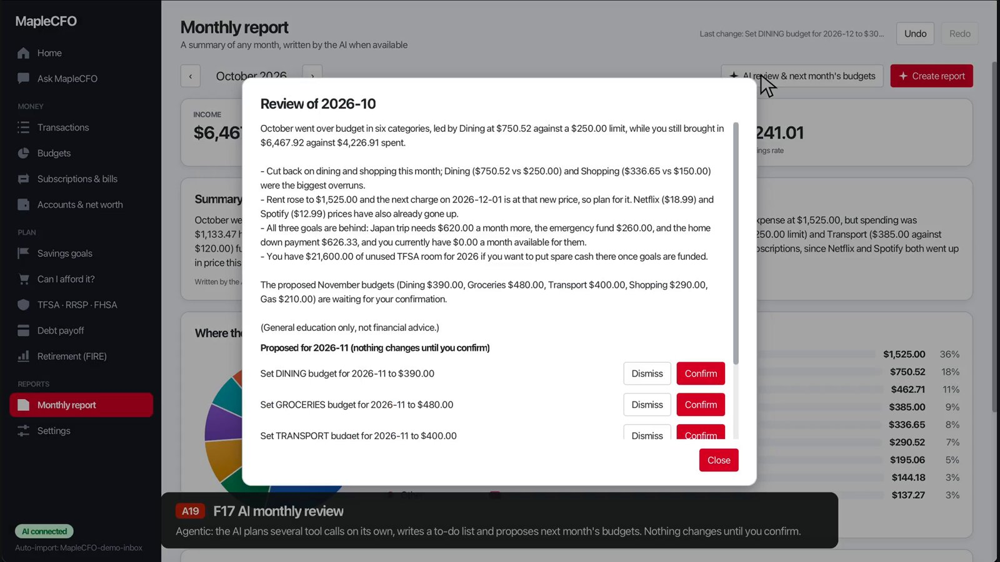

**In action (CLI).**

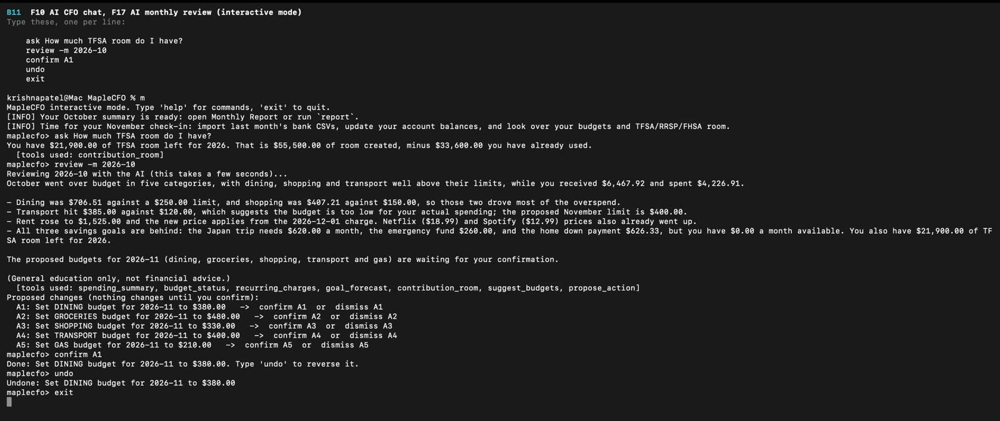

**How it is implemented.** `MonthlyReviewService.review` gives `CfoAgent.runTask` an instruction; the agent calls `spending_summary`, `budget_status`, `recurring_charges`, `goal_forecast`, `contribution_room` and `suggest_budgets` (`BudgetPlanner`: three-month average rounded up to $10), proposes up to five budgets with `propose_action`, and writes a to-do list. Each proposal is confirmed or dismissed separately (see SD15).

Classes: `MonthlyReviewService`; `CfoAgent.runTask`; `BudgetPlanner`; `BudgetSuggestionTool`. Key methods: `review`, `runTask`, `suggest`.

**Differences from the original requirement.** This feature was not in the Stage 1 design; it was added in Stage 2. Reason: Show real multi-step agent planning; turn the monthly check-in into concrete actions. Impact: `AgentResponse` now carries several proposals; Command + PendingActionStore reused.

---

### F18: Find transactions in plain English

**Type:** Hybrid · **Status:** Implemented · **Design patterns:** - · **Video:** [GUI A6 1:53](https://youtu.be/VF4bBqEF96I?t=113), [CLI B4 0:54](https://youtu.be/kkj3KK_1WIg?t=54)

**Original requirement.** New in Stage 2 (UC18, SD17). Find transactions by asking in plain English (for example "Uber Eats over $30 in October"): the AI fills in the search filters, Java checks every field and runs the search, and the user can see and change the filters.

**In action (GUI).**

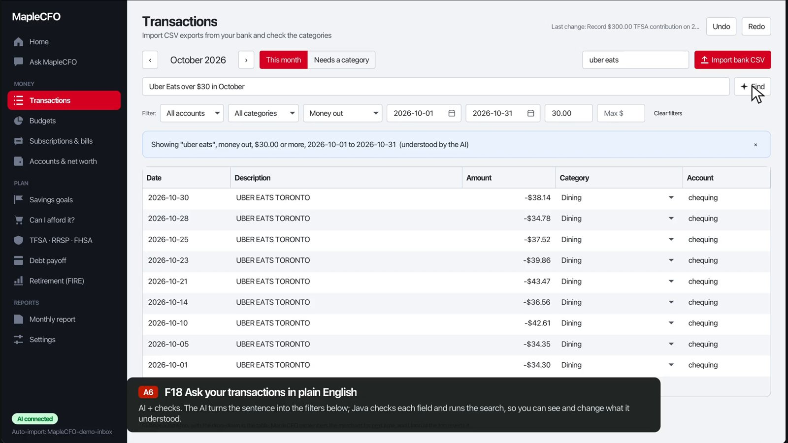

**In action (CLI).**

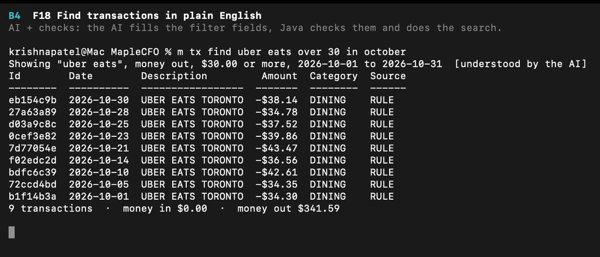

**How it is implemented.** `TransactionQueryParser.parse` asks the model to fill the fields of a `TransactionFilter`; `fromJson` checks each one (real dates, known accounts and categories, sensible amounts) and lists what it ignored. The GUI shows the result in the normal filter controls, so the user can see and change it.

Classes: `TransactionQueryParser` (AI fills filter fields; Java checks them); `TransactionFilter`. Key methods: `parse`, `fromJson`, `apply`, `describe`.

**Differences from the original requirement.** This feature was not in the Stage 1 design; it was added in Stage 2. Reason: Filters are powerful but slow to set. Impact: AI only fills checked fields; search stays deterministic.

---

### F19: Where extra money could go

**Type:** Hybrid · **Status:** Implemented · **Design patterns:** Template Method · **Video:** [GUI A12 3:27](https://youtu.be/VF4bBqEF96I?t=207), [CLI B8 1:44](https://youtu.be/kkj3KK_1WIg?t=104)

**Original requirement.** New in Stage 2 (UC19, SD18). Where could extra money go (a tax refund or bonus): Java splits the amount in a fixed educational order using the user's own debts, cash and room, and the AI only explains the split. Education, not advice.

**In action (GUI).**

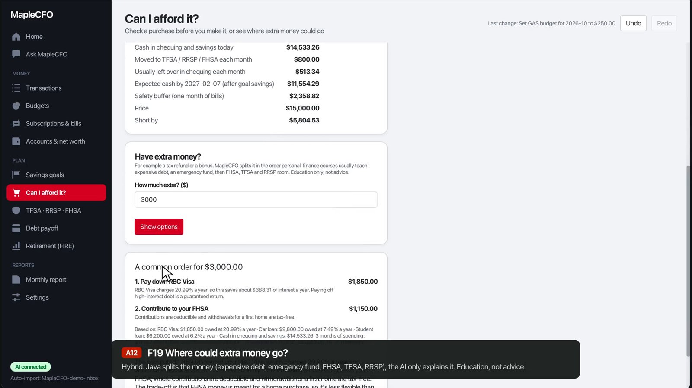

**In action (CLI).**

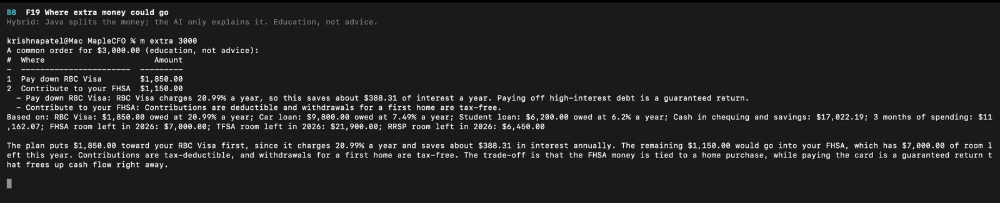

**How it is implemented.** `ExtraMoneyPlanner.plan` splits the amount in a fixed educational order (debts at 8% or more, an emergency fund of three months of spending, FHSA, TFSA, RRSP, cheaper debt) using the user's own debts, cash, spending and room. The GUI shows the split at once; `explainExtraMoney` asks the agent to explain it through `ExtraMoneyTool`.

Classes: `ExtraMoneyPlanner` (Java split); `ExtraMoneyTool`; `CfoAgent` explains. Key methods: `plan`, `explainExtraMoney`.

**Differences from the original requirement.** This feature was not in the Stage 1 design; it was added in Stage 2. Reason: A common question after a tax refund or bonus. Impact: New tool via Template Method; amounts from Java.

---

### CLI input methods and the standalone agent

**Original requirement.** Stage 1: a picocli CLI with one command per feature and an interactive mode. Instructor
feedback for Stage 2 (Nov 2026): the CLI must accept input from a file, standard input, an API call or another method,
and a standalone version of the agent must run directly from a terminal, for example
`java -jar Agent.jar -LLMAPI -input task.txt`.

**In action.** The `run` and `ask --file --json` modes (a test run in demo mode, without an API key, so the answers come
from the fixed rules):

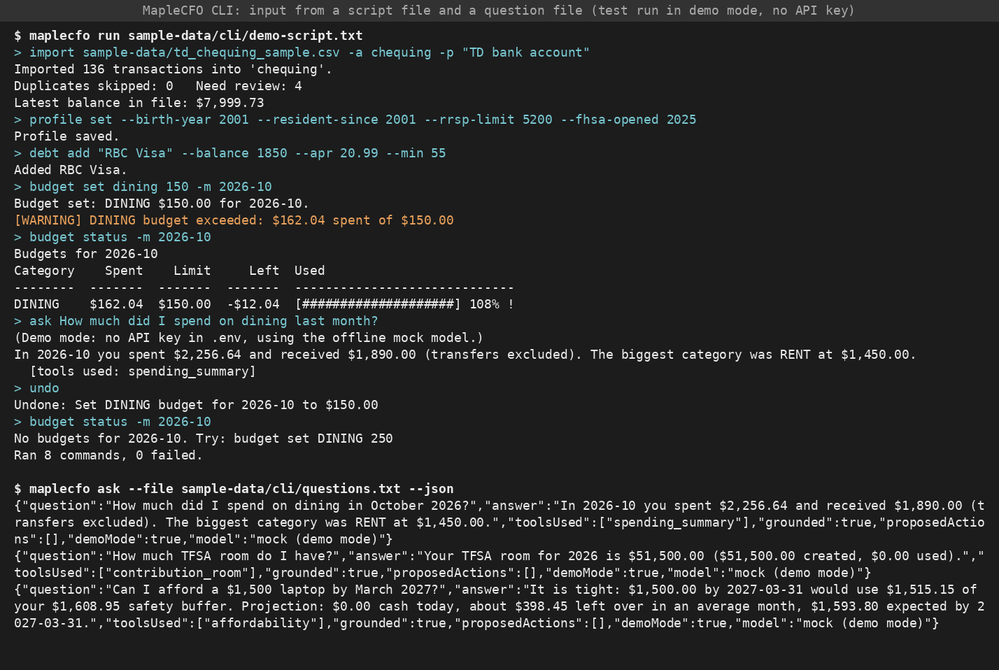

**How it is implemented.** `InputCommands` adds `run <file|->` (one command per line, in one session so `confirm`
and `undo` work across lines), `ask --file <file> --json` and `ask -` (questions from a file or standard input, one
JSON object per answer) and `serve --port 8080` (`GET /`, `GET /health`, `GET`/`POST /ask`, `POST /command` on
127.0.0.1). `TaskMode` runs the standalone agent: `java -jar target/maplecfo.jar -LLMAPI -input task.txt` reads the
whole file as one task, calls `MapleCfoFacade.runAgentTask` (the agent's multi-step loop with up to `-max-steps` tool
calls), and prints the answer, the tools used, whether every amount was checked, and the proposed changes, which are
applied only with `-confirm`. Options: `-LLMAPI`, `-offline`, `-model`, `-max-steps`, `-json`, `-output`, `-confirm`,
`--db`; see the README. All of them reuse the same commands and facade as typed input, so the results are the same.

**Differences from the original requirement.** Added after the instructor's feedback; nothing from Stage 1 was removed.
