# MapleCFO: Stage 2 Implementation Report

**EECS 3311 Software Design, Fall 2026 · Krishna Patel**  
Repository: <https://github.com/Krishna7997/EECS-3311-Project> · Videos: see Section 7

> Items marked **[TODO Krishna]** still need your input (video links, token/cost figures, your own wording). Remove this note before submitting.

---

## 1. Project overview and implementation status

**What it is.** MapleCFO is a personal-finance agent for Canadian students and young professionals. Users import the
CSV files their bank lets them download (no bank passwords, no bank connection). MapleCFO categorizes the transactions
and answers practical questions: am I on budget, which subscriptions went up, how much TFSA/RRSP/FHSA room do I have,
when could I retire early, which debt should I pay first, can I afford this, and where should extra money go.

**Users.** One person on their own computer. Data stays in a local SQLite database (`~/.maplecfo/maplecfo.db`). Only
small snippets are sent to the AI model: unknown merchant names, the first lines of an unknown CSV, chat questions with
their tool results, and summary figures.

**Interfaces.** A JavaFX GUI (13 pages, AtlantaFX theme) and a picocli CLI (one-shot commands and an interactive mode).
Both use the same `MapleCfoFacade`, so every feature works in both.

**AI / LLM integration.** Anthropic Claude through the `LlmClient` interface (`ClaudeClientAdapter`; model
`claude-haiku-5-5` by default, set in `.env`). The AI is used as an **agent**, not a text box:

- **F10 AI CFO chat:** a bounded reason-act loop (`CfoAgent`, up to 6 steps). The model chooses among 12 finance tools,
  reads their JSON results and answers. Every dollar amount in the answer is checked against the tool results
  (`ResponseValidator`); changes are only *proposed* and wait for the user's confirmation (Command pattern, undoable).
- **F17 AI monthly review:** a longer multi-step task (up to 10 steps) where the agent plans its own steps, gathers the
  figures, proposes up to five budgets and writes a to-do list.
- **F02, F12, F16, F18, F19:** the AI categorizes unknown merchants, writes the monthly summary, reads unknown bank
  formats, turns plain-English questions into filters and explains the extra-money plan. In each case Java checks the
  AI's answer before using it.

Without an API key the app runs in a clearly labelled **demo mode** (`MockLlmClient` with keyword rules), so it can be
installed and tried offline. Demo mode is a fallback, not the AI feature: the videos use the real model.

**Status.** All 15 Stage 1 features are implemented and working, and four new AI features were added (F16-F19), for 19
features in total. 280 JUnit tests pass. 8 design patterns from the course are implemented (Section 3). Limitations
are listed honestly in Section 6.4.

| | Count |
|---|---|
| Features (Stage 1 + new) | 15 + 4 = 19 |
| Java source files (main) | 200 in 21 packages |
| JUnit tests | 280 (all passing), 32 test classes |
| Line coverage (JaCoCo) | 59.7% overall, 89.7% excluding the JavaFX GUI package |
| Code commits Oct 20-26 / Oct 27-Nov 2 / Nov 3-9 | 5 / 7 / 25 |

---

## 2. Feature to implementation mapping

Type: **D** deterministic, **AI** AI-based, **H** hybrid. Video codes refer to Section 7 (A = GUI video, B = CLI video).

| ID and name | Stage 1 | Status | Implemented classes / files and responsibilities | Key methods | Patterns | Type | Video |
|---|---|---|---|---|---|---|---|
| F01 Import bank CSVs | F01 | Modified (format detection added) | `TransactionService` (import, duplicates, events); `CsvTransactionAdapter` (reads a CSV with a `ColumnMapping`); `DefaultProfiles` (TD, RBC, generic); `ImportResult` | `importFrom`, `detectProfile`, `importFile`, `matchesFirstRow` | Adapter, Observer | D | A3, B1 |
| F02 Categorize and correct | F02 | Implemented | `CategorizationService` (ordered chain); `RuleBasedCategorizer` + `DefaultRules` (~120 Canadian merchants, learned rules); `LlmCategorizer` (AI fallback); `RecategorizeCommand` | `categorizeAll`, `categorize`, `learn`, `recategorize` | Strategy, Command | H | A5, B3 |
| F03 Accounts and net worth | F03 | Implemented | `Account`, `AccountGroup`, `AssetComponent`; `AccountService`; `NetWorthService` (snapshots) | `buildAccountTree`, `getValue`, `computeSnapshot` | Composite | D | A9, B7 |
| F04 Budgets and alerts | F04 | Implemented | `BudgetService` (listens to imports, 80%/100% alerts); `SetBudgetCommand`; `AlertService` | `setBudget`, `getStatus`, `onEvent` | Observer, Command | D | A7, B5 |
| F05 Recurring charges | F05 | Modified (price steps, cancelled charges) | `RecurringChargeDetector`; `RecurringCharge` | `detect(txs, today)`, `build` | - | D | A8, B6 |
| F06 TFSA/RRSP/FHSA room | F06 | Modified (HBP/LLP, FHSA transfer, RRSP allowance) | `RegisteredAccountService`; `ContributionLimits`; `ContributionRoom`; `ContributionCheck`; `RepaymentPlan`; `ContributionKind` | `computeRoom`, `previewContribution`, `recordContribution`, `repaymentPlans` | - | D | A13, B9 |
| F07 FIRE projection | F07 | Modified (own target, target age, Coast FIRE) | `FireCalculator`; `FireInputs`; `FireProjection` | `project`, `yearsToFire`, `savingNeeded` | - | D | A16, B10 |
| F08 Debt payoff | F08 | Implemented | `DebtPayoffPlanner`; `PayoffStrategy`, `AvalancheStrategy`, `SnowballStrategy`; `PayoffPlan` | `plan`, `orderDebts` | Strategy | D | A15, B10 |
| F09 Savings goals | F09 | Implemented | `GoalService`; `CashFlowForecaster`; `GoalForecast`; `CreateGoalCommand` | `createGoal`, `forecast` | Command | D | A10, B7 |
| F10 AI CFO chat | F10 | Implemented | `CfoAgent`; `ToolRegistry`; `AbstractFinanceTool` + 12 tools; `PromptBuilder`; `ResponseValidator`; `PendingActionStore`; `ClaudeClientAdapter`, `MockLlmClient`, `LlmClientFactory` | `handle`, `runLoop`, `validate`, `execute` | Adapter, Template Method, Factory Method, Command | AI | A17, B11 |
| F11 Can I afford it? | F11 | Implemented (TIGHT verdict added) | `AffordabilityAnalyzer`; `AffordabilityResult`; `CashFlowForecaster` | `analyze` | - | D | A11, B7 |
| F12 Monthly report | F12 | Implemented | `ReportService`; `ReportSummarizer` (AI text checked against the figures, template fallback); `MonthlyReport` | `buildMonthlyReport`, `summarize`, `templateSummary` | - | H | A18, B12 |
| F13 Auto-sync and reminders | F13 | Modified (monthly check-in, choosable folder) | `ImportFolderWatcher`; `BalanceSyncService`; `ReminderService`; `SettingsRepository` | `start`, `processFile`, `accountFor`, `isMonthlyCheckinDue` | Observer | D | A1, B13 |
| F14 Detected contributions and RRSP estimate | F14 | Implemented | `ContributionDetector`; `RecordContributionCommand` (also moves money into the TFSA/RRSP/FHSA account); `RrspRoomEstimator` | `scan`, `detect`, `estimate(year, pa)` | Observer, Command | D | A2, A14, B9 |
| F15 Self-updating limits | F15 | Modified (GitHub issue instead of email) | `LimitsService`; `RemoteLimitsProvider`, `BundledLimitsProvider`, `LimitsCache`; `LimitsValidator`; `LimitsUpdateJob`, `CraLimitsScraper`, `GitHubIssueNotifier`, `ConsoleNotifier`; `.github/workflows/limits-update.yml` | `refreshIfStale`, `validate`, `run` | Strategy (providers) | D | A20, B14 |
| F16 AI reads an unknown bank format | New | Implemented | `AiFormatReader` (AI proposes a mapping; Java builds and test-reads it); `AiFormatReader.Proposal` | `propose`, `parseJson`, `saveFormatAndImport` | Adapter | H | A4, B2 |
| F17 AI monthly review | New | Implemented | `MonthlyReviewService`; `CfoAgent.runTask`; `BudgetPlanner`; `BudgetSuggestionTool` | `review`, `runTask`, `suggest` | Command, Template Method | AI | A19, B11 |
| F18 Find transactions in plain English | New | Implemented | `TransactionQueryParser` (AI fills filter fields; Java checks them); `TransactionFilter` | `parse`, `fromJson`, `apply`, `describe` | - | H | A6, B4 |
| F19 Where extra money could go | New | Implemented | `ExtraMoneyPlanner` (Java split); `ExtraMoneyTool`; `CfoAgent` explains | `plan`, `explainExtraMoney` | Template Method | H | A12, B8 |

### Design-to-implementation traceability (Stage 1 classes → implemented files)

The "Designed classes" column is copied from the Stage 1 traceability table (Stage 1 report, Section 8). Every designed
class exists under the same name in `src/main/java/com/maplecfo/` unless the last column says otherwise; the reasons
for each change are in Section 4.

| Feature | Designed classes (Stage 1) | Implemented classes / files | Status | Differences from the design |
|---|---|---|---|---|
| F01 | TransactionsView, MapleCfoFacade, TransactionService, MappingProfileRepository, ColumnMapping, TransactionImporter, CsvTransactionAdapter, TransactionRepository | All designed classes, plus `DefaultProfiles`, `ImportResult`, `TransactionFilter` | Modified | Format detected automatically (`detectProfile`) |
| F02 | CategorizationService, RuleBasedCategorizer, LlmCategorizer, LlmClient, PromptBuilder, RecategorizeCommand, CommandHistory, TransactionService | All designed classes, plus `DefaultRules` | Implemented | - |
| F03 | DashboardView, MapleCfoFacade, AccountService, NetWorthService, AssetComponent, AccountGroup, Account, AccountRepository | All except DashboardView → `HomeView` + `AccountsView` | Implemented | Dashboard split into GUI pages |
| F04 | BudgetView, BudgetService, SetBudgetCommand, CommandHistory, EventBus, AlertService, FinanceEventListener | All; BudgetView → `BudgetsView` | Implemented | Renamed view |
| F05 | DashboardView, MapleCfoFacade, TransactionService, RecurringChargeDetector | All; DashboardView → `SubscriptionsView`; plus `RecurringCharge` | Modified | Price steps and cancelled charges |
| F06 | PlanningView, RegisteredAccountService, ContributionLimits, ProfileRepository, ContributionRepository, EventBus | All; PlanningView → `RegisteredView`; plus `ContributionRoom`, `ContributionCheck`, `ContributionKind`, `RepaymentPlan` | Modified | HBP/LLP, FHSA transfer, RRSP allowance |
| F07 | PlanningView, MapleCfoFacade, FireCalculator | All; PlanningView → `RetirementView`; plus `FireInputs`, `FireProjection` | Modified | Own target, target age, Coast FIRE |
| F08 | PlanningView, DebtPayoffPlanner, PayoffStrategy, AvalancheStrategy, SnowballStrategy, DebtRepository | All; PlanningView → `DebtView`; plus `PayoffPlan` | Implemented | - |
| F09 | GoalsView, GoalService, CreateGoalCommand, CommandHistory, CashFlowForecaster | All, plus `GoalForecast` | Modified | Surplus shared between goals |
| F10 | ChatView, MapleCfoCli, CfoAgent, ConversationMemory, PromptBuilder, LlmClient, ClaudeClientAdapter, ToolRegistry, FinanceTool, AbstractFinanceTool, ResponseValidator, PendingActionStore | All, plus `LlmClientFactory`, `MockLlmClient`, `DemoRules`, 12 tool classes | Implemented | - |
| F11 | GoalsView / ChatView, AffordabilityTool, AffordabilityAnalyzer, CashFlowForecaster, GoalService, BudgetService, ProposeActionTool, PendingActionStore, CommandHistory | All; the GUI page is `AffordView`; plus `AffordabilityResult` | Modified | TIGHT verdict added |
| F12 | ReportView, MapleCfoCli, ReportService, ReportSummarizer, LlmClient, BudgetService, NetWorthService, RecurringChargeDetector | All, plus `MonthlyReport` | Implemented | - |
| F13 | ImportFolderWatcher, TransactionService, BalanceSyncService, AccountService, DebtRepository, ReminderService, EventBus | All, plus `SettingsRepository`, `SettingsView` | Modified | User-chosen folder, monthly check-in |
| F14 | ContributionDetector, RecordContributionCommand, PendingActionStore, CommandHistory, RegisteredAccountService, RrspRoomEstimator | All designed classes | Modified | Partial-year scaling, pension adjustment |
| F15 | LimitsService, LimitsProvider, RemoteLimitsProvider, BundledLimitsProvider, LimitsValidator, LimitsCache, LimitsUpdateJob, CraLimitsScraper, FailureNotifier, GitHubIssueNotifier, EmailNotifier | All except FailureNotifier → `LimitsNotifier` and EmailNotifier → `ConsoleNotifier` | Modified | No e-mail; bot opens a pull request or an issue |
| F16-F19 | New in Stage 2 (no Stage 1 classes) | See the mapping table above | New | UC16-UC19, SD15-SD18 |

### How the classes collaborate (user input to result)

- **F01 Import.** The user picks a file (GUI) or runs `import file -a chequing` (CLI). `MapleCfoFacade.importTransactionsAuto`
  asks `TransactionService.detectProfile` which saved `ColumnMapping` fits the first row, then `importFrom` creates a
  `CsvTransactionAdapter` for that mapping (Adapter: any bank layout becomes `Transaction` objects). Each row gets a
  fingerprint; rows already stored are counted as duplicates. New rows are categorized (F02), saved through
  `TransactionRepository`, and a `TRANSACTIONS_IMPORTED` event is published, so budgets, balances and contribution
  detection update themselves (Observer). The `ImportResult` (imported, duplicates, rejected rows with reasons) is shown.
- **F02 Categorize.** `CategorizationService` runs its strategies in order: `RuleBasedCategorizer` (learned rules first,
  then built-in keywords; the longest keyword wins), then `LlmCategorizer`, which accepts the AI's answer only when it
  is exactly one category name. A correction runs a `RecategorizeCommand` through `CommandHistory` (undoable) and saves
  a learned rule.
- **F03 Net worth.** `AccountService.buildAccountTree` builds groups (cash, registered, other, debts) of `Account` leaves;
  `getValue` on the root sums the tree, with liabilities negative (Composite). `NetWorthService` stores snapshots.
- **F04 Budgets.** `SetBudgetCommand` saves a `Budget`. `BudgetService` listens to import and recategorize events,
  recomputes `BudgetStatus` and publishes `BUDGET_WARNING` (80%) and `BUDGET_EXCEEDED` (100%) once; `AlertService`
  turns events into messages.
- **F05 Recurring.** `RecurringChargeDetector` groups 12 months of expenses by normalised merchant, checks that the gaps
  fit weekly, monthly or yearly (plus or minus 3 days), flags a price increase (latest charge or a step from one stable
  price to a higher one), labels variable bills, rolls the next date forward and drops charges that missed two dates.
- **F06 Room.** `RegisteredAccountService.computeRoom` loads the profile and the CRA limits (`LimitsService`), then
  applies the rules for each account type (TFSA room since age 18 with withdrawals returned on January 1, RRSP limit
  from the Notice of Assessment with the $2,000 allowance, FHSA $8,000/year with carry-forward, HBP/LLP that use no
  room). The contribution form calls `previewContribution` on every keystroke, which has no side effects.
- **F07 FIRE.** `FireInputs` validates the inputs; `FireCalculator.project` computes the target (spending / withdrawal
  rate, or the user's own target), simulates each year, adds what-if scenarios, the Coast FIRE number and, when a
  retirement age is given, the yearly saving needed (annuity formula).
- **F08 Debt.** `DebtPayoffPlanner` orders debts with the chosen `PayoffStrategy` (avalanche: highest rate first;
  snowball: smallest balance first) and simulates month by month.
- **F09 Goals / F11 Afford.** `CashFlowForecaster` averages income, spending and registered transfers over the last
  complete months. `GoalService.forecast` shares the monthly surplus between goals; `AffordabilityAnalyzer` adds cash,
  expected savings and a one-month buffer and returns YES / TIGHT / NO / INSUFFICIENT_DATA.
- **F10 Chat.** `CfoAgent.handle` builds the prompt (`PromptBuilder`), sends it with the tool schemas through
  `LlmClient`, runs the requested tools through `ToolRegistry` (each tool validates its arguments in
  `AbstractFinanceTool.execute`, Template Method), and loops until the model answers. `ResponseValidator` checks every
  amount; if one is not in a tool result the model gets one correction round, otherwise the answer is flagged. A
  `propose_action` call stores a `SetBudgetCommand` in `PendingActionStore` until the user confirms.
- **F12 Report.** `ReportService` computes income, spending by category, budgets, recurring costs and price increases
  for a month; `ReportSummarizer` asks the AI for a short summary and accepts it only if its numbers match the report,
  otherwise it uses a template.
- **F13 Auto-sync.** `ImportFolderWatcher` (Java `WatchService`) waits until a new file stops growing, detects its format,
  picks the account from the file name and imports it. `BalanceSyncService` reads the running balance and updates the
  account and linked debt. `ReminderService` raises the monthly check-in and "no import in 30 days" reminders.
- **F14 Contributions.** `ContributionDetector` listens to imports and proposes a `RecordContributionCommand` for each
  transfer that names exactly one of TFSA/RRSP/FHSA; on confirmation the room and the account balance both change.
  `RrspRoomEstimator` estimates RRSP room from a year of pay deposits (scaled for a partial year, minus the pension
  adjustment).
- **F15 Limits.** On start `LimitsService.refreshIfStale` tries `RemoteLimitsProvider` (GitHub, at most weekly), checks
  the data with `LimitsValidator` and caches it (`LimitsCache`), falling back to the bundled JSON. The weekly GitHub
  Actions job runs `LimitsUpdateJob`, which scrapes the CRA pages, validates the numbers and opens a pull request or,
  on a problem, an issue (`GitHubIssueNotifier`).
- **F16 AI format reader.** When no format fits, `AiFormatReader.propose` sends the first 8 lines to the model, turns the
  JSON reply into a `ColumnMapping` (invalid answers are rejected), and test-reads the whole file with
  `CsvTransactionAdapter`. The user sees a preview and the counts of rows read and rejected; only then is the format
  saved and the file imported (`saveFormatAndImport`).
- **F17 Monthly review.** `MonthlyReviewService.review` gives `CfoAgent.runTask` an instruction; the agent calls
  `spending_summary`, `budget_status`, `recurring_charges`, `goal_forecast`, `contribution_room` and `suggest_budgets`
  (`BudgetPlanner`: three-month average rounded up to $10), proposes up to five budgets with `propose_action`, and
  writes a to-do list. Each proposal is confirmed or dismissed separately (see SD15).
- **F18 Plain-English search.** `TransactionQueryParser.parse` asks the model to fill the fields of a
  `TransactionFilter`; `fromJson` checks each one (real dates, known accounts and categories, sensible amounts) and lists
  what it ignored. The GUI shows the result in the normal filter controls, so the user can see and change it.
- **F19 Extra money.** `ExtraMoneyPlanner.plan` splits the amount in a fixed educational order (debts at 8% or more,
  an emergency fund of three months of spending, FHSA, TFSA, RRSP, cheaper debt) using the user's own debts, cash, spending
  and room. The GUI shows the split at once; `explainExtraMoney` asks the agent to explain it through `ExtraMoneyTool`.

---

## 3. Implemented design patterns

All eight patterns from the Stage 1 design are implemented; Repository is used in addition. Each one solves a concrete
problem in the code.

### 3.1 Facade: `MapleCfoFacade`
- **Problem.** Two user interfaces (GUI and CLI) need about 25 services; without a single entry point each screen and
  command would wire services itself and the two interfaces would drift apart.
- **Participants.** Facade `MapleCfoFacade`; subsystems `TransactionService`, `BudgetService`, `RegisteredAccountService`,
  `CfoAgent`, `AiFormatReader`, `MonthlyReviewService`, etc.; clients: the 13 GUI views and the CLI command classes.
  `AppContext` (composition root) builds everything once.
- **Code.** `app/MapleCfoFacade.java` (e.g. `importTransactionsAuto`, `askCfo`, `runMonthlyReview`, `planExtraMoney`).
- **Why it fits.** Both interfaces call the same methods, so a feature built once works in both; tests use the facade
  end to end. **Matches Stage 1**; it gained the methods for F16-F19.

### 3.2 Adapter: `CsvTransactionAdapter`, `ClaudeClientAdapter`
- **Problem.** Every bank exports a different CSV layout, and the Anthropic HTTP API has its own message format; the
  rest of the code should see only `Transaction` objects and a simple `LlmClient`.
- **Participants.** Target `TransactionImporter` / `LlmClient`; adapters `CsvTransactionAdapter` (configured by a
  `ColumnMapping`) and `ClaudeClientAdapter` (wraps `HttpTransport`); `MockLlmClient` is a second `LlmClient`.
- **Code.** `importer/CsvTransactionAdapter.importFile`, `agent/llm/ClaudeClientAdapter.chat`.
- **Why it fits.** A new bank is a new mapping, not new code (F16 even lets the AI propose the mapping); the agent can
  run on Claude, on the offline mock or on a scripted fake in tests. **Matches Stage 1.**

### 3.3 Strategy: `PayoffStrategy`, `CategorizationStrategy`, `LimitsProvider`
- **Problem.** Debts can be paid in different orders; transactions can be categorized by rules or by the AI; limits can
  come from several sources. The algorithms must be swappable without `if/else` chains.
- **Participants.** `PayoffStrategy` with `AvalancheStrategy` and `SnowballStrategy` (context `DebtPayoffPlanner`);
  `CategorizationStrategy` with `RuleBasedCategorizer` and `LlmCategorizer` (context `CategorizationService`, an ordered
  chain); `LimitsProvider` with remote, cache and bundled providers (context `LimitsService`, ordered fallback).
- **Code.** `planning/DebtPayoffPlanner.plan`, `categorization/CategorizationService.categorizeAll`, `LimitsService.reload`.
- **Why it fits.** The GUI switches avalanche/snowball at run time; the AI categorizer is just a second strategy that is
  skipped in demo mode. **Matches Stage 1**; the limits providers are an extra use.

### 3.4 Observer: `EventBus` and `FinanceEventListener`
- **Problem.** After an import many things must update (budgets, alerts, balances, detected contributions, the GUI)
  without `TransactionService` knowing about all of them.
- **Participants.** Subject `EventBus` (`publish`, `subscribe`); event `FinanceEvent` with `EventType`; observers
  `BudgetService`, `AlertService`, `BalanceSyncService`, `ContributionDetector`, and the GUI (`MapleCfoApp` refreshes).
- **Code.** `events/EventBus.publish`, `BudgetService.onEvent`, `ContributionDetector.onEvent`.
- **Why it fits.** F13 and F14 were added as new listeners without changing the import code; a failing listener does not
  stop the others. **Matches Stage 1**; new event types `BUDGET_WARNING` and `AUTO_IMPORTED`.

### 3.5 Command: `UndoableCommand`, `CommandHistory`, `PendingActionStore`
- **Problem.** Edits must be undoable, and changes suggested by the AI or by automation must not run until the user
  agrees.
- **Participants.** `UndoableCommand` (`execute`, `undo`, `describe`); concrete `SetBudgetCommand`, `RecategorizeCommand`,
  `CreateGoalCommand`, `RecordContributionCommand`; invoker `CommandHistory` (undo/redo stacks); `PendingActionStore`
  holds proposed commands until `confirmProposedAction`.
- **Code.** `command/CommandHistory.run/undo/redo`, `agent/tools/ProposeActionTool`, `MapleCfoFacade.confirmProposedAction`.
- **Why it fits.** One mechanism gives Undo/Redo in both interfaces and a safe "propose, then confirm" step for F10, F14
  and F17. **Matches Stage 1**; used more widely (contributions, monthly review).

### 3.6 Composite: `AssetComponent`, `Account`, `AccountGroup`
- **Problem.** Net worth is a tree (cash, registered, debts, each with accounts) and should be computed the same way at
  every level.
- **Participants.** Component `AssetComponent` (`getValue`, `getChildren`); leaf `Account`; composite `AccountGroup`.
- **Code.** `domain/AccountGroup.getValue`, `planning/AccountService.buildAccountTree`.
- **Why it fits.** Liabilities return negative values, so every total is a plain sum. **Matches Stage 1.**

### 3.7 Template Method: `AbstractFinanceTool`
- **Problem.** All 12 agent tools must validate the model's arguments and turn failures into errors the model can read;
  no tool may skip this.
- **Participants.** Abstract class `AbstractFinanceTool` with the final template `execute` (validate the schema, call
  `doExecute`, catch failures); concrete tools such as `AffordabilityTool`, `ExtraMoneyTool`, `BudgetSuggestionTool`.
- **Code.** `agent/AbstractFinanceTool.execute`, `validateArgs`, `doExecute`.
- **Why it fits.** The two new tools for F17 and F19 only wrote `doExecute`. **Matches Stage 1.**

### 3.8 Factory Method: `LlmClientFactory`
- **Problem.** The app must choose the real Claude client or the offline mock from the configuration.
- **Participants.** `LlmClientFactory.create(AppConfig, rules)` returns an `LlmClient`.
- **Why it fits.** No other class knows whether a key exists. **Matches Stage 1.**

### 3.9 Repository (additional)
`Repository<T, ID>` and its interfaces (transactions, accounts, budgets, goals, debts, profile, contributions, mapping
profiles, settings) with SQLite implementations and in-memory versions for tests. Services never see SQL.
`DatabaseManager` migrates old databases (adds new columns, keeps data).

### 3.10 Updated UML

The class diagram was updated to the implemented system in UMLet (8 parts), the use-case diagram gained UC16-UC19,
SD13 was corrected, and SD15-SD18 were added for the new features. All diagrams (editable `.uxf` and `.png`) are in
[`docs/stage2/diagrams`](https://github.com/Krishna7997/EECS-3311-Project/tree/main/docs/stage2/diagrams); the class
diagrams are shown in Appendix A and the new sequence diagrams in Appendix B.

---

## 4. Changes and rationale

Original design → implemented change → reason → impact.

| Area | Original design (Stage 1) | Implemented change | Reason | Impact |
|---|---|---|---|---|
| New feature | - | **F16** AI reads an unknown bank format (`AiFormatReader`, UC16, SD16) | Users of other banks had to map columns by hand | Any bank's CSV can be imported after one check of the preview; uses Adapter (new `ColumnMapping`) |
| New feature | - | **F17** AI monthly review with proposed budgets (`MonthlyReviewService`, `BudgetPlanner`, `CfoAgent.runTask`, UC17, SD15) | Show real multi-step agent planning; turn the monthly check-in into concrete actions | `AgentResponse` now carries several proposals; Command + PendingActionStore reused |
| New feature | - | **F18** plain-English transaction search (`TransactionQueryParser`, `TransactionFilter`, UC18, SD17) | Filters are powerful but slow to set | AI only fills checked fields; search stays deterministic |
| New feature | - | **F19** where to put extra money (`ExtraMoneyPlanner`, `ExtraMoneyTool`, UC19, SD18) | A common question after a tax refund or bonus | New tool via Template Method; amounts from Java |
| F01 | User picks a mapping profile on every import | Format detected from the columns (`detectProfile`, `matchesFirstRow`); choice optional; transaction filters added | Found while testing the GUI: picking the bank every time was confusing | Used by F01, F13 and F16 |
| F05 | Latest charge vs. average; 6-month window | 12-month window, price-step detection, cancelled charges dropped, new price used for yearly cost | The 22-month demo data showed price changes labelled "amount varies" and cancelled subscriptions still listed | More accurate subscription page and report |
| F06 | Contribution or withdrawal; anything over the limit is over-contributed | RRSP $2,000 allowance; same-year withdrawal clears an excess; HBP/LLP withdrawals and repayments; FHSA→RRSP transfer; pension adjustment | Checked against CRA rules after testing | `ContributionKind`, `RepaymentPlan`, DB migration |
| F06/F03 | Confirmed contributions change only room | They also move money into the TFSA/RRSP/FHSA account; forecasts subtract registered transfers | Net worth dropped after a contribution (found in testing) | `RecordContributionCommand`, `CashFlowForecast.cashSurplus` |
| F07 | Fixed 5% return, 4% rule | Own target, target age with saving needed, Coast FIRE, editable return/withdrawal rate, "use my numbers", remembered plan | Requested during review | `FireInputs`/`FireProjection` fields; tool accepts the new arguments |
| F11 | YES / NO | YES / TIGHT / NO / INSUFFICIENT_DATA | "Affordable only by using the safety buffer" needed its own answer | GUI and agent show the verdict |
| F09 | Each goal forecast alone | Monthly surplus shared between goals | Several goals could each claim the same money | More realistic forecasts |
| F13 | Fixed inbox folder; 30-day reminder | User-chosen folder (Settings); monthly check-in; account from the file name | Usability | `SettingsRepository`, `ReminderService.isMonthlyCheckinDue` |
| F14 | RRSP estimate from last year's income | Partial year scaled to 12 months; pension adjustment subtracted; labelled as a low estimate | Most users import only part of a year | `RrspRoomEstimator.estimate(year, pa)` |
| F15 (pattern detail) | `EmailNotifier` sends failure emails | `GitHubIssueNotifier` + `ConsoleNotifier`; bot opens a pull request instead of committing | An SMTP password in CI is a security risk; a PR lets a human review new limits | SD13 updated; no secrets needed |
| GUI | Tabbed main window with 7 views | Sidebar with 13 pages, Home checklist, in-window pop-ups (AtlantaFX `ModalPane`), live checks | Krishna found the first GUI hard to use and dated | Class diagram 6/8 redrawn |
| Agent | One proposal per answer, 6 steps | `runTask` with more steps for long tasks; list of proposals; memory not used for tasks | Needed by F17 | Class diagram 5/8 |
| Persistence | Schema fixed | `DatabaseManager` adds new columns to old databases | New fields (pension adjustment) must not break existing data | Migration test |

No Stage 1 feature or pattern was removed.

---

## 5. AI tools and collaboration log

### 5.1 Tools and models

| Tool / platform | LLM / model | Purpose and example tasks | Total tokens | Money cost |
|---|---|---|---|---|
| Claude (Anthropic) | claude-opus-5-5 (configured) | Writing all Java code and JUnit tests from the Stage 1 design (all 19 features, 8 patterns, GUI, CLI), bug diagnosis, demo dataset, README, UML updates, this report draft | **[TODO Krishna: from claude.ai usage]** | **[TODO Krishna]** |
| Anthropic Claude API (inside MapleCFO) | claude-haiku-5-5 | Runtime LLM for F02 categorization, F10 chat, F12 summary, F16-F19 (my own key in `.env`) | **[TODO Krishna: Anthropic Console → Usage]** | **[TODO Krishna: Console → Cost]** |

**About the model name.** The Claude app was set to `claude-opus-5-5`, but the app does not show which model served
each individual reply, and it can switch models (for example as a fallback). So `claude-opus-5-5` is the configured
model, not a guarantee for every interaction. The model used inside MapleCFO is exact, because the app sends it with
every API call (`LLM_MODEL`, default `claude-haiku-5-5`).

The app itself shows the tokens used in a session (`ai` command in the CLI), which helped estimate the runtime cost.

### 5.2 How the collaboration worked

Following the course rule, the code was written by the AI from the Stage 1 design; I gave the instructions, reviewed
each change, made the design decisions, ran the tests and the application on my own computer, reported defects, and
made every commit. Each change came as one patch per commit; I applied it, ran `mvn test` and the app, and pushed only
when it worked. The full log (40 entries) is in
[`docs/stage2/AI_Collaboration_Log.md`](https://github.com/Krishna7997/EECS-3311-Project/blob/main/docs/stage2/AI_Collaboration_Log.md).

### 5.3 Representative interactions

**1. Protecting the API key**

- *Task:* set up the Claude API key without exposing it.
- *Input:* "Can you check my file if I did it right?"
- *AI contribution:* checked the local files without printing the key; found the key had been typed into
  `.env.example` (a committed file) instead of `.env`; confirmed it was never committed or pushed; restored the
  placeholder and verified `.env` is git-ignored.
- *Human contribution:* **[TODO Krishna: e.g. "I created a new key, put it only in .env and deleted the exposed key in the Anthropic Console."]**
- *Outcome:* no key in the repository or its history; the handout's key-protection rules are followed.

**2. Testing the CLI found two F05 defects**

- *Task:* run the built application on real use and check the results.
- *Input:* I ran `--help`, `import`, `recurring` and `fire` on my Mac and shared the output.
- *AI contribution:* found a next-expected date in the past and a "price went up" flag on a variable utility bill.
- *Human contribution:* ran the commands on my own machine and shared the real output for review; **[TODO Krishna: your words]**
- *Outcome:* next dates now roll forward and variable bills are not flagged (commit `e832174`).

**3. F10 AI CFO agent**

- *Task:* implement the bounded tool-calling agent from SD08.
- *Input:* "Implement the agent with grounding checks and confirm-before-change."
- *AI contribution:* `CfoAgent` loop, `ToolRegistry`, `AbstractFinanceTool` (Template Method), tools, `ResponseValidator`,
  `PendingActionStore`, CLI `ask/confirm/dismiss`.
- *Human contribution:* ran the tests, then asked "How much did I spend on dining last month?" with my own data; the
  answer ($162.04) matched my bank data.
- *Outcome:* committed `439f701`; answers are grounded in tool results.

**4. Rent counted as a transfer**

- *Task:* AI categorizer and monthly report.
- *AI contribution:* `LlmCategorizer`, `ReportService`, `ReportSummarizer` with figure checking.
- *Human contribution:* tested `report -m 2026-09` and found September spending was far too low ($921.61 instead of
  $2,371.61) because rent paid by e-transfer was categorised as TRANSFER.
- *Outcome:* transfer rules now run last, so "rent" wins; re-imported on a fresh database (`e494302`, `439f701`).

**5. Automatic bank-format detection (my idea)**

- *Task:* stop asking the user to pick the CSV format.
- *Input:* "Instead of selecting the CSV type, should we make it dynamic?"
- *AI contribution:* detection from the file's columns in the GUI and CLI, with a clear message when nothing matches.
- *Human contribution:* suggested the change while testing the GUI.
- *Outcome:* `8535411`; later reused by auto-import and by F16.

**6. GUI usability rework**

- *Task:* make the GUI easy to use.
- *Input:* "The GUI is not user friendly, hard to navigate and still looks old-fashioned"; I listed the problems (too
  many fields, nowhere to start, unclear where to enter what) and chose a full rework over a restyle.
- *AI contribution:* 13 pages in a sidebar, Home checklist, short forms in pop-ups, empty states, AtlantaFX theme.
- *Human contribution:* rejected two earlier GUI versions, found overlapping report labels on my laptop, and found
  that pop-ups opened as separate windows on macOS.
- *Outcome:* `63a6ed7`, `60d6ae5`, `921f649`.

**7. Following the money for TFSA contributions**

- *Task:* check what happens to a TFSA contribution.
- *Input:* "Is the TFSA contribution being added to the net worth or other things?"
- *AI contribution:* confirmed contributions now also update the TFSA/RRSP/FHSA account and forecasts subtract regular
  registered transfers; monthly check-in and a choosable import folder.
- *Human contribution:* found the gap (net worth dropped after a contribution) by asking how the money flows; asked for
  the monthly reminder and folder setting.
- *Outcome:* `ada881a`.

**8. A test that depended on my computer**

- *AI contribution:* two tests read `MAPLECFO_INBOX` from the environment; settings now come from `AppConfig` and
  tests use empty settings.
- *Human contribution:* `mvn test` failed on my Mac; I reported the output.
- *Outcome:* tests no longer depend on the machine (`921f649`).

**9. TFSA stayed negative after a withdrawal**

- *AI contribution:* room only counted withdrawals from earlier years; a same-year withdrawal now clears an excess
  (but adds no new room), matching CRA rules.
- *Human contribution:* found the bug by over-contributing and then withdrawing in the GUI.
- *Outcome:* `3ec76b8`, 3 new tests.

**10. Real CRA rules (HBP, LLP, allowance)**

- *Input:* "How does the limit work in real life?", then "let's implement this".
- *AI contribution:* explained the rules, then implemented the RRSP $2,000 allowance, HBP/LLP withdrawals and
  repayments, FHSA-to-RRSP transfers and the pension adjustment, with a database migration.
- *Human contribution:* asked for the real rules to be implemented and reviewed them; **[TODO Krishna: anything you checked on canada.ca]**
- *Decision:* LLP repayment start simplified (noted in limitations).
- *Outcome:* `6f536e4`, `a985778`.

**11. Realistic test data exposed detector gaps**

- *Input:* "Can we add more CSV files so there is a good dataset for testing and the videos?"
- *AI contribution:* a 22-month fake dataset with a load script and `DemoDatasetTest`; the data showed that price
  changes from months ago were labelled "amount varies" and cancelled subscriptions were still listed; both fixed.
- *Human contribution:* asked for the dataset; **[TODO Krishna: what you checked in the demo]**
- *Outcome:* `f7058dd`.

**12. New AI features F16-F19 and FIRE options**

- *Input:* "Can we introduce more AI features or use AI to drive things?"; later "in FIRE can we change the target".
- *AI contribution:* proposed four features; I chose all four. Each keeps numbers in Java and asks before changing
  anything. FIRE gained an own target, a target age, Coast FIRE and editable assumptions.
- *Human contribution:* chose the features; **[TODO Krishna: what you tested with your key]**
- *Outcome:* `f76b1dc`, `1b9f20b`, `5ef8658`, `f9070e6`, `4666a5d`.

**What I rejected or corrected.** I rejected the first two GUI designs; reported every failing build and test on my
machine (including the iCloud duplicate-file problem, which led me to move the project out of iCloud); asked for real
CRA rules instead of the simplified Stage 1 ones; and checked that every amount the agent showed matched my data.

---

## 6. Development and verification summary

### 6.1 Weekly commit summary

Only commits that change implementation or test code are counted (documentation-only commits such as the README,
the AI log and the UML are not). Every commit was pushed during its period.

| Period | Code commits | Minimum |
|---|---|---|
| Period 1: Oct 20-26 | 5 | 5 |
| Period 2: Oct 27-Nov 2 | 7 | 5 |
| Period 3: Nov 3-9 | 25 | 5 |

**Period 1: Oct 20-26**

| Commit | Date | Change |
|---|---|---|
| [`0ca6048`](https://github.com/Krishna7997/EECS-3311-Project/commit/0ca6048) | Oct 23 | Maven project and Money value object with tests |
| [`a2ff9b2`](https://github.com/Krishna7997/EECS-3311-Project/commit/a2ff9b2) | Oct 23 | Domain model: accounts (Composite), transactions, budgets, goals, debts |
| [`5051cb3`](https://github.com/Krishna7997/EECS-3311-Project/commit/5051cb3) | Oct 23 | F07 FIRE calculator |
| [`a369c1b`](https://github.com/Krishna7997/EECS-3311-Project/commit/a369c1b) | Oct 23 | F08 debt payoff planner (Strategy) |
| [`db01f84`](https://github.com/Krishna7997/EECS-3311-Project/commit/db01f84) | Oct 23 | F05 recurring charge detector |

**Period 2: Oct 27-Nov 2**

| Commit | Date | Change |
|---|---|---|
| [`7c29fe5`](https://github.com/Krishna7997/EECS-3311-Project/commit/7c29fe5) | Oct 28 | F06 room with CRA limits; EventBus (Observer) |
| [`1904991`](https://github.com/Krishna7997/EECS-3311-Project/commit/1904991) | Oct 28 | F04 budgets with 80%/100% alerts |
| [`4e43342`](https://github.com/Krishna7997/EECS-3311-Project/commit/4e43342) | Oct 28 | Command pattern: undo/redo |
| [`395b727`](https://github.com/Krishna7997/EECS-3311-Project/commit/395b727) | Oct 29 | F02 rule-based categorization |
| [`7643cbb`](https://github.com/Krishna7997/EECS-3311-Project/commit/7643cbb) | Nov 1 | F01 CSV import, duplicates, sample data |
| [`0c503e2`](https://github.com/Krishna7997/EECS-3311-Project/commit/0c503e2) | Nov 1 | SQLite repositories |
| [`0d2ae51`](https://github.com/Krishna7997/EECS-3311-Project/commit/0d2ae51) | Nov 1 | Facade and picocli CLI |

**Period 3: Nov 3-9**

| Commit | Date | Change |
|---|---|---|
| [`e832174`](https://github.com/Krishna7997/EECS-3311-Project/commit/e832174) | Nov 3 | LLM layer (Claude adapter, mock, factory) + F05 fixes |
| [`439f701`](https://github.com/Krishna7997/EECS-3311-Project/commit/439f701) | Nov 3 | F10 AI CFO agent |
| [`e494302`](https://github.com/Krishna7997/EECS-3311-Project/commit/e494302) | Nov 3 | F02 AI categorizer, F12 report |
| [`c4d5af8`](https://github.com/Krishna7997/EECS-3311-Project/commit/c4d5af8) | Nov 3 | F03 net worth, F09 goals |
| [`b925d3a`](https://github.com/Krishna7997/EECS-3311-Project/commit/b925d3a) | Nov 6 | F11 Can I afford it? |
| [`06d505b`](https://github.com/Krishna7997/EECS-3311-Project/commit/06d505b) | Nov 6 | JavaFX GUI part 1 |
| [`fd9a000`](https://github.com/Krishna7997/EECS-3311-Project/commit/fd9a000) | Nov 6 | GUI part 2 (planning, chat, report) |
| [`05e7ee7`](https://github.com/Krishna7997/EECS-3311-Project/commit/05e7ee7) | Nov 6 | F13 auto-import, F14 contribution detection |
| [`fc1ab76`](https://github.com/Krishna7997/EECS-3311-Project/commit/fc1ab76) | Nov 6 | F15 limits refresh and weekly bot |
| [`5f45d8a`](https://github.com/Krishna7997/EECS-3311-Project/commit/5f45d8a) | Nov 6 | More unit tests |
| [`63a6ed7`](https://github.com/Krishna7997/EECS-3311-Project/commit/63a6ed7) | Nov 6 | GUI redesign |
| [`8535411`](https://github.com/Krishna7997/EECS-3311-Project/commit/8535411) | Nov 6 | Automatic bank-format detection |
| [`60d6ae5`](https://github.com/Krishna7997/EECS-3311-Project/commit/60d6ae5) | Nov 6 | GUI UX rework |
| [`ada881a`](https://github.com/Krishna7997/EECS-3311-Project/commit/ada881a) | Nov 6 | Registered transfers follow the money, monthly check-in |
| [`921f649`](https://github.com/Krishna7997/EECS-3311-Project/commit/921f649) | Nov 6 | In-window pop-ups, live room check |
| [`6f536e4`](https://github.com/Krishna7997/EECS-3311-Project/commit/6f536e4) | Nov 6 | Account activity, RRSP allowance |
| [`3ec76b8`](https://github.com/Krishna7997/EECS-3311-Project/commit/3ec76b8) | Nov 6 | Withdrawals clear an over-contribution |
| [`a985778`](https://github.com/Krishna7997/EECS-3311-Project/commit/a985778) | Nov 6 | HBP/LLP, FHSA transfer, pension adjustment, filters |
| [`f7058dd`](https://github.com/Krishna7997/EECS-3311-Project/commit/f7058dd) | Nov 6 | Demo dataset, recurring price steps |
| [`f76b1dc`](https://github.com/Krishna7997/EECS-3311-Project/commit/f76b1dc) | Nov 6 | F16 AI bank-format reader |
| [`1b9f20b`](https://github.com/Krishna7997/EECS-3311-Project/commit/1b9f20b) | Nov 6 | F18 plain-English search |
| [`5ef8658`](https://github.com/Krishna7997/EECS-3311-Project/commit/5ef8658) | Nov 6 | F19 extra money |
| [`f9070e6`](https://github.com/Krishna7997/EECS-3311-Project/commit/f9070e6) | Nov 6 | F17 AI monthly review |
| [`4666a5d`](https://github.com/Krishna7997/EECS-3311-Project/commit/4666a5d) | Nov 6 | F07 FIRE options |
| [`e4aff8a`](https://github.com/Krishna7997/EECS-3311-Project/commit/e4aff8a) | Nov 7 | Logo: app icon and sidebar |

### 6.2 Checks performed

- **Automated tests:** 280 JUnit 5 tests in 32 classes, all passing (`mvn test`). They cover the domain rules, every
  calculator with exact expected values (FIRE, debt, room, affordability, goals), import (duplicates, bad rows,
  format detection), categorization, events and undo/redo, SQLite repositories and migration, every agent tool and its
  argument validation, the agent loop with scripted model replies (tool use, grounding check, correction round,
  proposals), the AI features F16-F19 with a fake model (valid, invalid and unreadable AI answers), CLI commands end to
  end, and the 22-month demo dataset (`DemoDatasetTest`).
- **Coverage (JaCoCo 0.8.12):** 59.7% of lines overall and 89.7% outside the JavaFX GUI package.
- **Running the application:** after each patch I ran `mvn test`, the CLI commands and the GUI on my Mac with the fake
  sample and demo data, and on Nov 7 ran F02, F10, F12 and F16-F19 with my real API key (this found the F17 defect
  below). Both demonstration videos were recorded with the real key.
- **GUI screenshots:** every page and pop-up was rendered headlessly (with and without data, at small and large window
  sizes) to catch layout problems before each commit.
- **Security checks:** `.env` and real bank CSVs are git-ignored, `.env.example` holds only a placeholder, and no key
  is in the repository or its history.

Full testing and the KUMA agent validation follow in Stage 3.

### 6.3 Important defects found and corrected

| Defect | Found by | Fix |
|---|---|---|
| Recurring charges showed a next date in the past; variable bills flagged as price increases | Running the CLI on sample data | Roll dates forward; only fixed-price charges flagged (`e832174`) |
| Rent paid by e-transfer counted as a transfer, so spending was far too low | Testing the monthly report | Transfer rules run last (`439f701`) |
| Folder-watcher test could finish while an import was still writing | Coverage work | Test waits; `close()` waits for a running import (`5f45d8a`) |
| Report pie labels overlapped and text was cut off on a laptop screen | Using the GUI | Legend list beside the pie, responsive layout (`60d6ae5`) |
| Two tests depended on an environment variable on my machine | `mvn test` on my Mac | Settings read through `AppConfig`; tests use empty settings (`921f649`) |
| Dialogs opened as separate windows on macOS | Using the GUI | In-window pop-ups (`921f649`) |
| A confirmed TFSA contribution lowered net worth | Asking how the money flows | Contribution also moves money into the account (`ada881a`) |
| TFSA stayed over-contributed after a withdrawal | Using the GUI | Same-year withdrawal clears the excess (`3ec76b8`) |
| Price changes from months ago showed as "amount varies"; cancelled subscriptions listed | 22-month demo data | Price-step detection, 12-month window, stopped charges dropped (`f7058dd`) |
| iCloud Desktop created "Name 2.java" copies and changed build output | Failing builds on my Mac | Never committed; project moved out of iCloud |
| AI monthly review said "Rent rises to $1,525 on 2026-12-01", but the rent had already gone up (it read the next charge date as the date of the increase) | Testing F17 with my real API key | `recurring_charges` now says in words that the increase already happened; the review instruction says a next charge date is not a price change (`560cc56`) |
| Card payments, savings transfers and TFSA/FHSA contributions were listed as monthly bills, doubling the yearly total ($49,409 instead of $28,483) | Recording the CLI demo video | Transfers between own accounts are skipped; new test `ignoresTransfersBetweenOwnAccounts` (`5f3de3d`) |

### 6.4 Remaining limitations

- Bank data comes only from CSV exports (no live bank connection, by design). TD, RBC and a generic layout are built
  in; other banks need F16 (AI key) or a manual mapping.
- AI features need an Anthropic API key. Without it, F10, F12, F17-F19 use clearly labelled fixed rules and F16 asks
  the user to choose the format.
- Tax rules are simplified for education: the RRSP estimate uses after-tax pay (so it is low), LLP repayments start in
  the 5th year, provincial differences and tax refunds are not calculated, and nothing is tax or investment advice.
- Proposals waiting for confirmation and the undo history are kept in memory, so in the CLI they work across commands
  only in interactive mode (each one-shot command is a new process).
- Recurring detection needs at least 3 charges, so yearly charges appear only after three years of data.
- Net-worth history records a snapshot only when a balance changes.
- The JavaFX GUI is tested by running it and by screenshots, not by unit tests (hence the lower overall coverage).
- The weekly limits bot depends on the CRA page layout; if it changes, the validator rejects the data and the bot opens
  an issue instead of updating.
- Single user and a local, unencrypted SQLite file.

---

## 7. Demonstration index

Video A (GUI, 6:25): https://youtu.be/VF4bBqEF96I · Video B (CLI, 4:10): https://youtu.be/kkj3KK_1WIg · Both are unlisted on YouTube and open
without an access request. Each link below starts at the feature's segment. Every segment shows the feature ID and
name, how it is started, the input, the result, and a caption saying what it does and where the AI is involved; error
cases are included where they exist (A7, B5, B10). Both videos were recorded on my Mac with the fake demo data and my
real API key (the key is never shown). Both are screen recordings of my Mac. The GUI tour clicks through the app by itself (a recording helper in a
separate file, not part of the app); in the CLI video a helper script types each command in my Terminal.

| Feature | GUI (Video A) | CLI (Video B) |
|---|---|---|
| F01 Import bank CSVs | [A3 0:49](https://youtu.be/VF4bBqEF96I?t=49) | [B1 0:09](https://youtu.be/kkj3KK_1WIg?t=9) |
| F02 Categorize and correct | [A5 1:34](https://youtu.be/VF4bBqEF96I?t=94) | [B3 0:41](https://youtu.be/kkj3KK_1WIg?t=41) |
| F03 Accounts and net worth | [A9 2:44](https://youtu.be/VF4bBqEF96I?t=164) | [B7 1:28](https://youtu.be/kkj3KK_1WIg?t=88) |
| F04 Budgets and alerts | [A7 2:09](https://youtu.be/VF4bBqEF96I?t=129) | [B5 1:04](https://youtu.be/kkj3KK_1WIg?t=64) |
| F05 Recurring charges | [A8 2:34](https://youtu.be/VF4bBqEF96I?t=154) | [B6 1:21](https://youtu.be/kkj3KK_1WIg?t=81) |
| F06 TFSA/RRSP/FHSA room | [A13 3:41](https://youtu.be/VF4bBqEF96I?t=221) | [B9 1:54](https://youtu.be/kkj3KK_1WIg?t=114) |
| F07 FIRE projection | [A16 4:24](https://youtu.be/VF4bBqEF96I?t=264) | [B10 2:20](https://youtu.be/kkj3KK_1WIg?t=140) |
| F08 Debt payoff | [A15 4:11](https://youtu.be/VF4bBqEF96I?t=251) | [B10 2:20](https://youtu.be/kkj3KK_1WIg?t=140) |
| F09 Savings goals | [A10 2:58](https://youtu.be/VF4bBqEF96I?t=178) | [B7 1:28](https://youtu.be/kkj3KK_1WIg?t=88) |
| F10 AI CFO chat | [A17 4:48](https://youtu.be/VF4bBqEF96I?t=288) | [B11 2:39](https://youtu.be/kkj3KK_1WIg?t=159) |
| F11 Can I afford it? | [A11 3:06](https://youtu.be/VF4bBqEF96I?t=186) | [B7 1:28](https://youtu.be/kkj3KK_1WIg?t=88) |
| F12 Monthly report | [A18 5:22](https://youtu.be/VF4bBqEF96I?t=322) | [B12 3:13](https://youtu.be/kkj3KK_1WIg?t=193) |
| F13 Auto-sync and reminders | [A1 0:09](https://youtu.be/VF4bBqEF96I?t=9) | [B13 3:24](https://youtu.be/kkj3KK_1WIg?t=204) |
| F14 Detected contributions, RRSP estimate | [A2 0:27](https://youtu.be/VF4bBqEF96I?t=27), [A14 4:02](https://youtu.be/VF4bBqEF96I?t=242) | [B9 1:54](https://youtu.be/kkj3KK_1WIg?t=114) |
| F15 Self-updating limits | [A20 6:04](https://youtu.be/VF4bBqEF96I?t=364) | [B14 3:46](https://youtu.be/kkj3KK_1WIg?t=226) |
| F16 AI reads an unknown bank format | [A4 1:12](https://youtu.be/VF4bBqEF96I?t=72) | [B2 0:19](https://youtu.be/kkj3KK_1WIg?t=19) |
| F17 AI monthly review | [A19 5:36](https://youtu.be/VF4bBqEF96I?t=336) | [B11 2:39](https://youtu.be/kkj3KK_1WIg?t=159) |
| F18 Find transactions in plain English | [A6 1:53](https://youtu.be/VF4bBqEF96I?t=113) | [B4 0:54](https://youtu.be/kkj3KK_1WIg?t=54) |
| F19 Where extra money could go | [A12 3:27](https://youtu.be/VF4bBqEF96I?t=207) | [B8 1:44](https://youtu.be/kkj3KK_1WIg?t=104) |
| Demo mode (no API key) | - | [B15 3:58](https://youtu.be/kkj3KK_1WIg?t=238) |

---

## Appendix A: Updated class diagrams (Stage 2, as implemented)

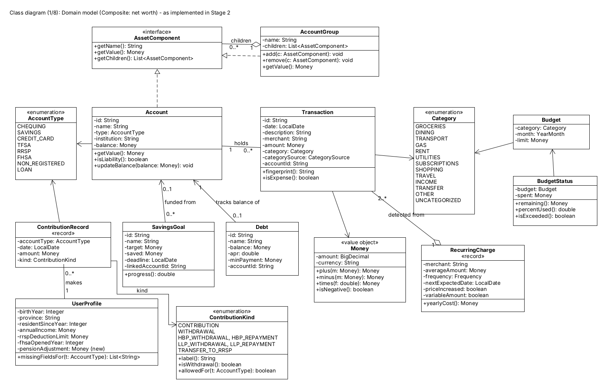

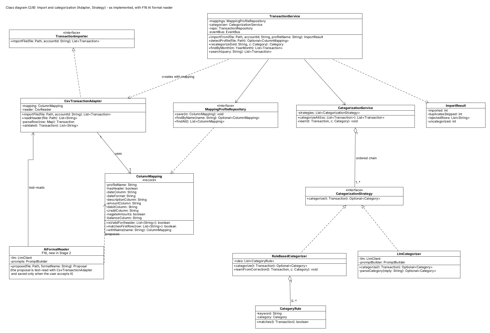

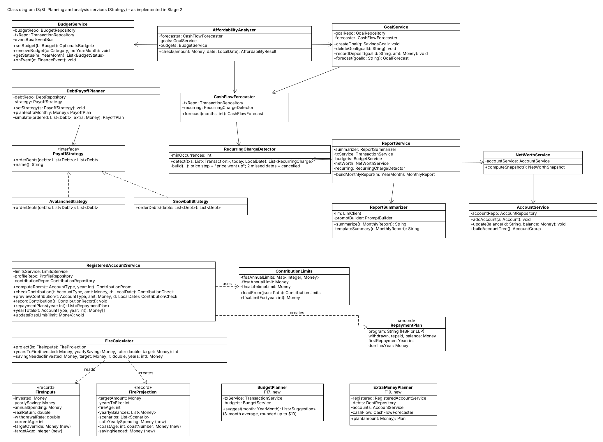

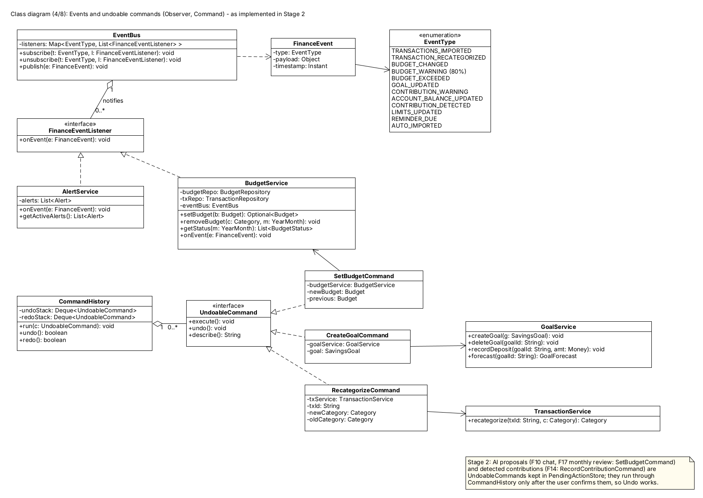

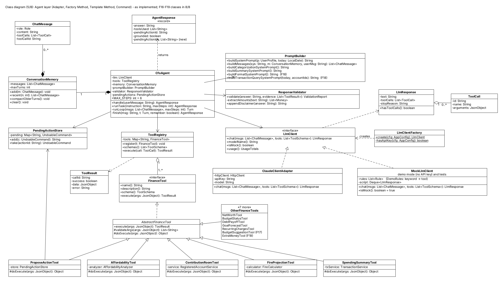

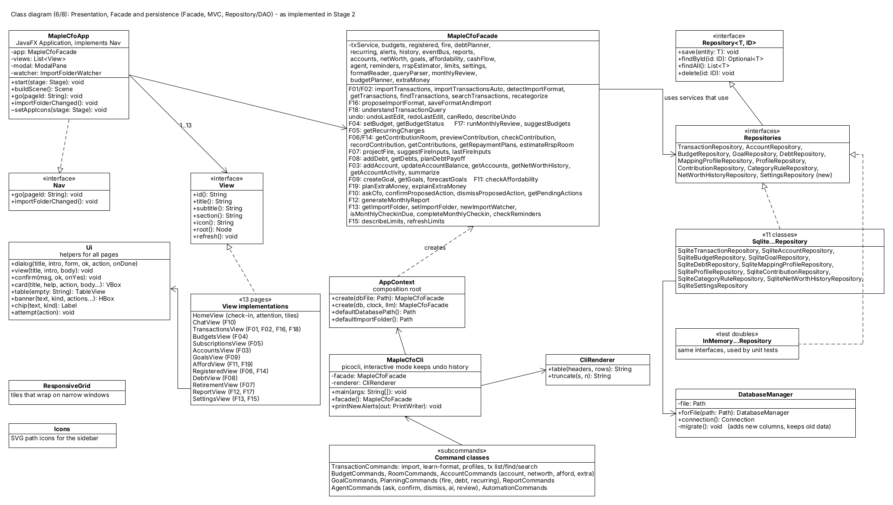

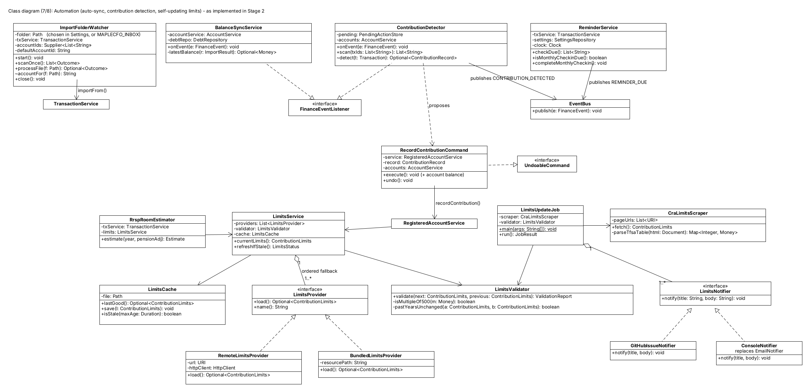

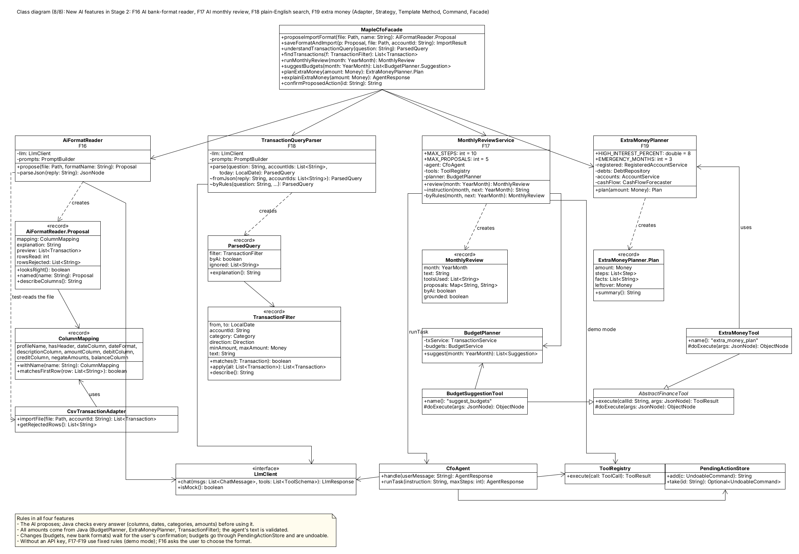

## Appendix B: Use cases and new or changed sequence diagrams

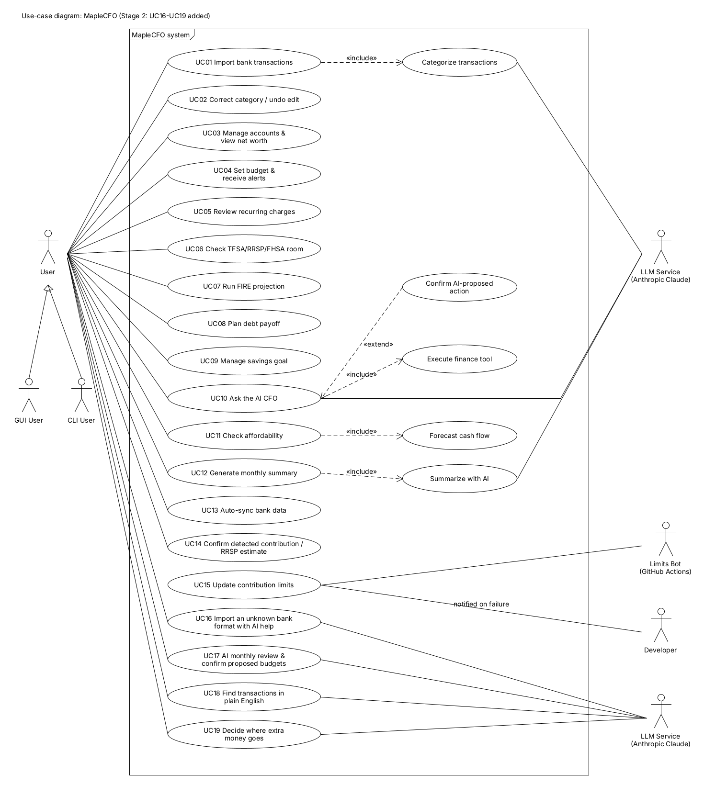

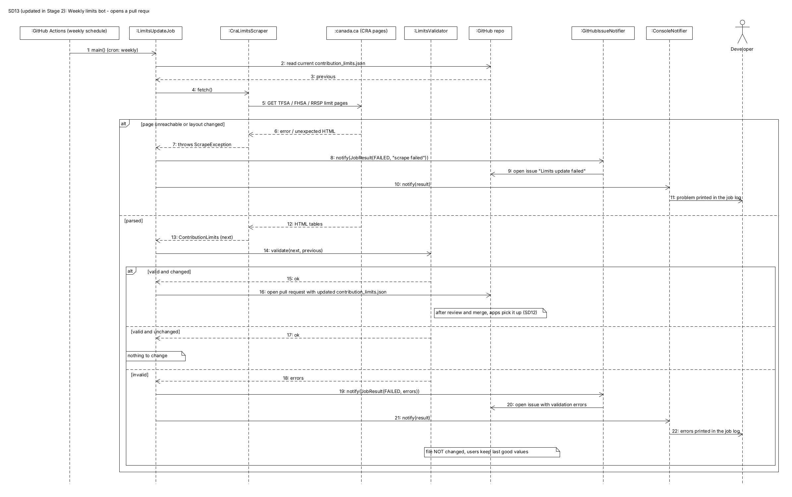

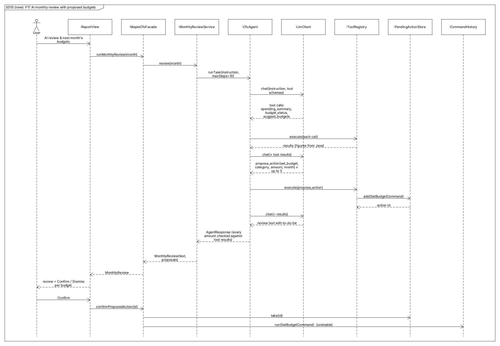

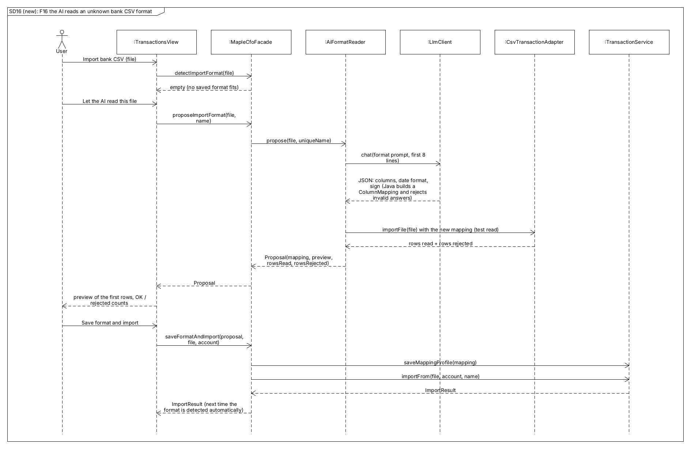

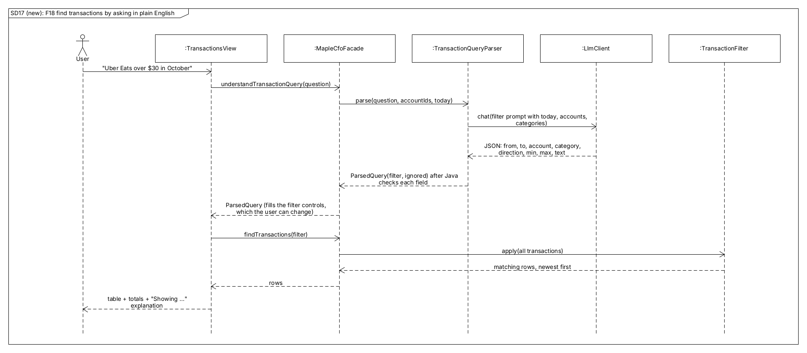

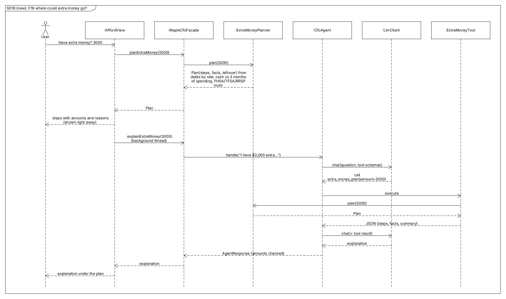
